## 14. Inform (transactional alerts) & Personalize (web experiences)

Storees has no Inform or Personalize module: transactional alerts are built as event-triggered flows, and its only storefront surface is an opt-in popup (both MoEngage add-ons were disabled, so their screens were rebuilt from the dashboard's JS bundle and public docs). The flow route covers channels, WhatsApp content and payload mapping well, but three P0s undercut it as an alert system (UI-built email steps send a hard-coded fallback instead of the chosen template; the event API that triggers alerts accepts the public storefront key and lets a caller overwrite a customer's phone; SMS has no India DLT IDs), alongside P1 gaps in retries, channel fallback, transactional handling of flow sends, email logging and queue priority. Personalize is almost entirely missing: there are no WYSIWYG, API or split-URL experiences, no on-site A/B tests, and no affinity or in-session targeting.

### MoEngage overview

Inform and Personalize are paid add-ons, and neither is enabled in this workspace. Every route of both modules shows the same kind of promo page: a hero, a channel-routing diagram, four benefit tabs, a "Learn more" docs link and an "I'm interested" modal that sends a sales request. The capabilities below come from the dashboard's own JS bundles and from MoEngage's public docs.

- **Inform** is an API-first service for multi-channel transactional alerts:
  - **Builder:** three steps, Alert Details → Content → Publish, with saved drafts. Publishing issues an Alert ID; an optional reference name can stand in for it in API calls.
  - **Channels:**
    - SMS: DLT template ID, shortened and tracked links, dynamic sender routing.
    - Email: drag-and-drop, custom HTML (typed, pasted or zip) or saved templates; attachments.
    - Push: Android, iOS and Web; iOS Live Activities; expiry, priority and interruption levels.
    - WhatsApp; RCS behind a feature flag.
  - **Sending order:** in parallel; in sequence on sender failure (up to four fallbacks); or in sequence on delivery failure (wait 1-60 minutes). Up to 5 retries with 200 ms exponential backoff, and an "Ignore DND" option per alert.
  - **Content logic:** reusable rule sets that pick the template per recipient (Dynamic Template Selector), and custom payload mapping.
  - **Send API:** `POST /v1.0/alerts/send` with Basic auth plus `MOE-APPKEY`; `transaction_id` idempotency (5-minute window, 409 on duplicates); 10,000 requests/min by default; a sandbox; a 3 s P90 SLA; IP allow-listing on request.
  - **Per alert:** an Info page, Analytics (request, channel, locale and personalization-failure views) and Logs.
  - **Settings:** fall back to profile attributes, and PII masking.
- **Personalize** changes website and app content per visitor:
  - **Experience types:** Web (WYSIWYG visual editor on the live site), Web & App (API payloads fetched server-side) and Split URL Testing.
  - **Targeting:** up to 10 audiences × 5 variations. Criteria: user property, behaviour, affinity and custom segments, plus in-session data (UTM, new or returning, day and time, geo, device, OS, browser). Also URL rules and a global control group.
  - **Delivery:** manual or Merlin AI traffic allocation; a schedule; up to 5 conversion goals with a 36 h window; a priority level for resolving conflicts.
  - **Governance and reporting:** an approval workflow and experience analytics.

| Page visited | URL path |
|---|---|
| Inform > All Alerts | `/v4/inform/transaction-alerts` |
| Inform > New Alert (create-alert route) | `/v4/inform/transaction-alerts/create` |
| Inform settings (Settings > Miscellaneous > Inform) | `/v4/settings-v2/others/informs` (also `/v4/inform/settings`) |
| Personalize > All Experiences | `/v4/experience/web` |
| Create New (+) > PERSONALIZE > Experience (experience-type picker) | Create New modal; cards link to `/v4/experience/web/create?type=visual-editor`, `server-side`, `split-url` |
| Personalize create routes (gated) | `/v4/experience/web/create?type=…`, `/v4/experience/web?createExperience=true` |

**Capture limits.**
- **Real screens not viewable:** the alert list, alert wizard, Info, Analytics and Logs, the Inform settings tabs, the experience list and wizard, and the visual editor never rendered. Every row marked "bundle" or "docs" was read from MoEngage's code or docs, not seen.
- **Not sent:** Submit was never clicked in either "I'm interested" modal, so no sales request went out.
- **No changes:** nothing was created, changed or deleted.

### Storees counterpart

There is no Alerts or Experiences area. The pieces that do the same jobs:

- **Flows are the alert engine.**
  - UI: `/flows` and `/flows/[id]` (`packages/frontend/src/app/(dashboard)/flows/page.tsx`, `packages/frontend/src/components/flows/StructuredFlowBuilder.tsx`). The send-node wizard is `packages/frontend/src/components/flows/SendNodeConfigModal.tsx`.
  - API: `/api/flows` (`packages/backend/src/routes/flows.ts`).
  - Runtime: `packages/backend/src/workers/triggerWorker.ts` enrols customers, allowing one live trip per flow per customer. `packages/backend/src/services/flowExecutor.ts` runs the steps.
- **Triggers:**
  - Shopify order, fulfilment, refund, checkout and cart webhooks (`packages/backend/src/routes/webhooks.ts`).
  - The public event API `POST /api/v1/events` (`packages/backend/src/routes/v1Events.ts`).
  - Event Sources inbound webhooks: UI at `/event-sources/[id]`, receiver `POST /api/hooks/:token` (`packages/backend/src/routes/hooks.ts`, `packages/backend/src/services/inboundWebhookService.ts`).
- **Delivery:**
  - SMS, WhatsApp and push go through `packages/backend/src/services/deliveryService.ts`, which runs consent → frequency cap → reachability → plan limit → queue. The worker is `packages/backend/src/workers/deliveryWorker.ts`, with one provider per channel from `packages/backend/src/services/providers/`.
  - Email skips that pipeline: `sendEmail` (`packages/backend/src/services/emailService.ts`) calls the provider directly.
- **Content:** the template library at `/templates` (`packages/frontend/src/app/(dashboard)/templates/page.tsx`, `packages/backend/src/routes/templates.ts`) and WhatsApp templates with Meta approval (`packages/backend/src/routes/whatsappAdmin.ts`).
- **Transactional handling:**
  - Broadcast campaigns have a Promotional/Transactional content type (`packages/frontend/src/app/(dashboard)/campaigns/create/page.tsx`).
  - WhatsApp UTILITY and AUTHENTICATION templates are treated as transactional automatically.
  - Flow sends are always marked promotional, and event-triggered campaigns are a disabled "Soon" card.
- **Observability:**
  - Notification Logs at `/logs` (`packages/frontend/src/app/(dashboard)/logs/page.tsx`, `packages/backend/src/routes/logs.ts`). Email never appears there.
  - The Event Debugger at `/debugger`, plus a per-customer Debug tab and analytics on each flow.
- **On-site:**
  - Opt-in popups at `/widgets` (`packages/frontend/src/app/(dashboard)/widgets/page.tsx`), rendered by `packages/sdk/src/widget.ts`. No sidebar link points to the page.
  - An in-app pull API, `GET /api/v1/in-app-messages` (`packages/backend/src/routes/v1InAppMessages.ts`), that no SDK renders.
  - Recommendations and social proof in `packages/backend/src/services/decisioningService.ts`, reachable only through the admin-only `/api/recommendations`.
- **Add-on gating:** plan entitlements (`packages/backend/src/services/entitlementService.ts`) and self-serve billing through Shopify at `/settings/billing`.

### Parity table

| Area | Feature | MoEngage | Storees | Evidence | Gap / recommendation | Priority | Effort |
|---|---|---|---|---|---|---|---|
| Inform: overview | Inform module (paid add-on) | Every Inform route shows the promo: "paid add-on feature … not enabled"; flag `campaigns_inform_feature` | 🟡 Partial | No alert entity or Alerts nav item (`Sidebar.tsx:54-71`). Transactional sending is spread over the campaign content type (`campaigns/create/page.tsx:1116-1117`), WhatsApp UTILITY/AUTHENTICATION templates treated as transactional (`deliveryService.ts:31-43`) and event-triggered flows (`types.ts:578`; `triggerWorker.ts`) | Order and shipping alerts work only as flows: there is no alert object with its own ID, channel order, logs or analytics. A customer can have one live trip per flow (`triggerWorker.ts:120-153`), so a second order placed while a trip is active or waiting gets no alert. | P2 | L |
| Inform: overview | Multi-provider routing behind one integration (30+ providers) | Diagram: Your Brand → Single API → Inform → Email / SMS / WhatsApp / Push / Any channel, each routed to vendors | 🟡 Partial | `providers/index.ts:17-38`; `settings/page.tsx:351-397`; `WhatsappChannelPanel.tsx:18-22`. Email: Resend, SendGrid, Postmark, Mailgun, SES. SMS: Twilio, Gupshup, Bird, Vonage; the Pinnacle "SMS + RCS" card has no `sms_pinnacle` provider. WhatsApp in the UI: Storees-managed, Meta, Pinnacle (Twilio, Gupshup, Bird and Vonage are backend-only). Push: FCM. One provider per channel (`channelProviderRegistry.ts:170-200`) | About 12 providers, one active per channel. No per-alert provider choice and no failover, except that a failed non-Resend email is retried once on Resend (`emailService.ts:54-88`). | P2 | L |
| Inform: overview | "Any channel" through a custom connector | The routing diagram's "Any channel" branch | ✅ Full | Flow HTTP Request node: any method and URL, `{{token}}` interpolation in URL, headers and body; the response is stored for later steps (`types.ts:734-747`; `flowExecutor.ts:822-880`; `StructuredFlowBuilder.tsx:330`) | Parity for calling another channel's API from a journey. A failed call is stored and the trip continues, with no retry. Outbound webhooks fire only on segment enter and exit (`useWebhooks.ts:40-47`). | — | — |
| Inform: API | Single send API for every channel (`POST /v1.0/alerts/send`) | One request with a payload per channel (recipient, personalized attributes, sender attributes, attachments); returns a request_id and a status per channel | ❌ Missing | `/api/v1` exposes events, events/batch, customers and identify (`v1Events.ts:114,274,563,989`), plus import, optin, recognize and in-app-messages; none sends a message. The nearest path is asynchronous: `POST /api/v1/events` or `/api/hooks/:token` → event → flow → queued send. That path also rejects any 12-digit property value as "Aadhaar" and masks 9-18-digit values to XXXX1234 (`dataMasking.ts:37-48,60-90`), so a 12-digit AWB fails the whole event | A headless backend cannot say "send template X to user Y now" and get a status back. Add `POST /api/v1/messages`, authenticated with the secret key, that calls `deliveryService.send` as transactional and returns message ids. | P1 | M |
| Inform: overview | Template Management (edit alert content without deploying code) | Promo tab: unify, view, add and edit alerts without engineering | 🟡 Partial | Library for email, SMS, push and in-app, plus WhatsApp with Meta's approval lifecycle (`templates/page.tsx`; `routes/templates.ts`; `routes/whatsappAdmin.ts`). The send node picks a template with a preview and a variable mapping (`SendNodeConfigModal.tsx:147-245`). Seeded order-confirmation and shipping templates exist for all four channels (`seedTemplates.ts:216,352,630,635,780,1000,1014`). **Defect:** the email node saves the template UUID (`SendNodeConfigModal.tsx:198,216`), but the executor looks it up by name with no project filter (`flowExecutor.ts:678-682`) and on a miss sends a hard-coded "You left something behind!" email (`:717-727`). SMS, push and WhatsApp steps load by id and work | An order-confirmation email built in the UI goes out as the abandoned-cart fallback, and seeded steps match a template name that every project shares. Look templates up by id within the project (the same P0 as modules 06 and 13). No versioning or approval. | P0 | S |
| Inform: overview | Centralized Logs (debug alerts across channels and providers) | Promo tab "De-bug your alerts in real time", with API Performance and Channel Performance panels | 🟡 Partial | Notification Logs at `/logs`: channel, status, source and search filters; failure and block reasons; role-based PII masking (`logs/page.tsx`; `routes/logs.ts:17-141`). Flow debugger (`FlowDebugPanel.tsx`; `routes/flows.ts:356`) and Event Debugger `/debugger`. Email never writes a `messages` row: flows and campaigns call `sendEmail` directly (`emailService.ts:32-89`; `flowExecutor.ts:750`; `campaignService.ts:993`). Gupshup SMS rejections are recorded as sent, because no error field is read (`gupshupProvider.ts:80`) | Email alerts are absent from logs, flow stats and the debugger, and there is no per-provider view. Log email sends in `messages` with the provider message id, so receipts attach. | P1 | M |
| Inform: overview | Growth Opportunity (cross-sells and promotions in transactional messages) | Promo tab "Turn transactional into revenue-generating streams" | 🟡 Partial | Flow emails get `{{cart_items}}` and a `{{recommended_products}}` grid (`flowExecutor.ts:684-701`; `productBlockRenderer.ts`). WhatsApp, SMS and push variables can use "Smart content" sources (`VariablePanel.tsx:318-341`). But flow decision values come only from a top-level `product_id` on the trigger (`flowExecutor.ts:660-663`). Order events carry products only inside `line_items` (`eventProcessor.ts:336-346`), so in order and shipping alerts these values are empty and WhatsApp sends "-". The picker's "Based on last viewed product" is never read (`types.ts:1110`). The email grid falls back to per-customer picks (`decisioningService.ts:235-247`), but only renders once the template-lookup P0 is fixed | Cross-sell works for product-level triggers (cart, product view, back in stock), not for order alerts. Fall back to `buildDecisionVarsForCustomer`, which campaigns already use (`campaignService.ts:928`), or to the first line item. Grid cards have no product link: the products table has no URL column (`schema.ts:240-273`). | P2 | S |
| Add-on gating | "I'm interested" contact-sales modals and "Learn more" docs links | Prefilled Subject and Message; Submit sends `POST /dash/auth/enable_feature_request`; Learn more opens the docs | ⭐ Storees better | Plan entitlements are enforced on the server (`entitlementService.ts:15-80`; `useEntitlements.ts`). A locked panel shows "Upgrade to unlock" (`WhatsappChatbotPanel.tsx:75-81`), and a trial banner links to billing (`TrialBanner.tsx`). Self-serve plans are billed through Shopify (`settings/billing/page.tsx:39-86`) | Instant self-serve activation beats a sales form. Caveats: upgrading needs a connected Shopify store (`billingService.ts:81`, "Store not connected"), and the locked state has no benefit tabs, diagram or docs link. | — | — |
| Inform: alert builder | Entry points: Create New > INFORM > Alerts; sidebar New Alert (permission-gated) and All Alerts | Create modal item "Alerts" links to the create route; New Alert hidden without the INFORM create/manage permission | 🟡 Partial | Triggered sends are created in Flows, an admin-only nav item (`Sidebar.tsx:62`), or from the flow template gallery (`routes/flows.ts:552-566`). Roles grant whole screens (`settings/roles/page.tsx`; `capabilities.ts:15-19`). No global Create menu and no alert list | No dedicated entry point or list for alerts, and permissions cannot separate creating from viewing. | P3 | S |
| Inform: alert builder | Three-step alert wizard, drafts, Publish/Update, Alert ID on publish | Alert Details → Content → Publish; "Draft saved successfully."; publishing creates the Alert ID and opens Alert Info | 🟡 Partial | Flow builder with draft, active and paused states (`flows/[id]/page.tsx`; `StructuredFlowBuilder.tsx`). Activation is blocked only by unapproved WhatsApp templates (`routes/flows.ts:207-268`). Each send node is a three-step modal: Template → Variables → Settings (`SendNodeConfigModal.tsx:30`) | No publish step that issues an alert id callable from the API or verifies a test request. | P2 | M |
| Inform: alert builder | Alert Details fields: name, reference name/ID for API calls, description, tags, Teams | Name 5-256; optional reference name used instead of the Alert ID; description; tags; teams | 🟡 Partial | `flows` holds only a name and description (`schema.ts:325-345`) | No stable API alias, tags or team ownership. | P3 | S |
| Inform: channels & fallback | Alert channels: SMS, Email, Push, WhatsApp | "Select the desired channels …", with a maximum of N per alert | ✅ Full | `actionType` send_email, send_push, send_sms or send_whatsapp (`types.ts:668-701`). A flow can hold any number of send nodes, run through `sendEmail` or `deliveryService.send` (`flowExecutor.ts:583-806`) | Channel coverage is at parity; content and transactional handling are separate rows. | — | — |
| Inform: channels & fallback | RCS ("Use SMS as fallback of RCS" or as a separate channel) | Behind the `inform_rcs` flag | ❌ Missing | No RCS provider. The Pinnacle SMS card promises "SMS + RCS messaging with rich media" (`settings/page.tsx:373`), but no `sms_pinnacle` provider is registered (`providers/index.ts:25-29`) | No RCS rich cards and no RCS with SMS fallback. Remove the RCS wording until it exists. | P3 | L |
| Inform: channels & fallback | Sender selection: SMS connector, sender groups, Dynamic Sender Routing | Pick a connector or other configured senders; routing conditions | ❌ Missing | One provider and sender per channel per project (`channelProviderRegistry.ts:170-200`). The send node has a recipient picker on step 1 and only UTM on its Settings step (`SendNodeConfigModal.tsx:329-350,529-603`). Verified From addresses can be chosen in campaigns only (`routes/emailSenders.ts`) | No sender choice per alert and no routing rules (by country, brand or cost). | P3 | M |
| Inform: channels & fallback | Channel order "In parallel" | Two channels at once | ✅ Full | Consecutive send nodes with no Delay queue each channel immediately (`flowExecutor.ts:159-170`; `deliveryService.ts:114-127`) | None. | — | — |
| Inform: channels & fallback | Channel order "In sequence (on Sender Failure)" with up to four fallbacks | Fallback on payload errors, vendor 4xx/5xx or rejection | ❌ Missing | A provider error marks the message failed and returns (`deliveryService.ts:177-203`). No channel fallback exists anywhere. A synchronous failure emits no `<channel>_failed` event, because only webhook receipts do (`messageStatusService.ts:76-87`), so a flow cannot branch on it | A rejected WhatsApp send (paused template, auth error) is never retried on SMS or email. Add a fallback channel to the send node, fired on provider errors. | P2 | M |
| Inform: channels & fallback | Channel order "In sequence (on Delivery Failure)": wait 1-60 minutes, then send the fallback | Default channel plus one fallback, with a delivery wait | 🟡 Partial | Can be built by hand: send WhatsApp → Delay → "Has done event `whatsapp_delivered`" → No → send SMS. Receipts emit `<channel>_delivered/_read/_failed` (`messageStatusService.ts:76-87`), checked since the trip started (`flowExecutor.ts:473-512`). Fragile: without an End step on the Yes branch, that path falls through into the SMS step, because the next step is simply the next node in the list (`flowExecutor.ts:366-369`; module 06 P0). Flow emails emit no receipts | No built-in fallback on the send node; each alert needs three extra nodes and depends on provider receipts. Add "if not delivered within N minutes, send on <channel>". | P1 | M |
| Inform: channels & fallback | Automatic retries (up to 5, exponential backoff of 200 ms) | Shown on Alert Info; "Include delivery retry details" in analytics | ❌ Missing | The delivery queue is set to 3 attempts with backoff (`queue.ts:85-96`), but `executeSend` catches every error and marks the message failed without rethrowing (`deliveryService.ts:177-203`), so BullMQ never retries. Only a failed non-Resend email gets one Resend attempt (`emailService.ts:54-88`). The env-gated legacy Pinnacle provider retries 3 times, but only when a project has no channel provider (`pinnacleProvider.ts`). Campaigns have a manual "Retry failed" (`routes/campaigns.ts:816-851`) | A timeout, 5xx or 429 fails the alert for good. Rethrow retryable errors, keeping 4xx final, so the existing queue retries. | P1 | S |
| Inform: channels & fallback | DND / quiet hours per alert ("Ignore DND", otherwise drop or queue) | Per channel; flag `inform_dnd_enabled` | ❌ Missing | Quiet hours appear only in a docstring (`deliveryService.ts:27`). The checks are consent → cap → reachability → plan → queue (`deliveryService.ts:79-127`); searched quiet hours, DND, send window | Non-urgent alerts cannot be held overnight, and urgent ones cannot be marked exempt. Modules 03 and 06 rate project quiet hours P1 for marketing sends. | P2 | M |
| Inform: channels & fallback | Transactional handling: alerts skip frequency caps, unsubscribes, bounces and SMS opt-in | From docs | 🟡 Partial | The campaign content type Transactional skips caps and promotional opt-outs, and sends email through the transactional provider (`campaigns/create/page.tsx:1116-1117`; `deliveryService.ts:79-96`; `emailProviderRegistry.ts:45-79`). WhatsApp UTILITY/AUTHENTICATION are automatic (`deliveryService.ts:31-43`). Flows hard-code `messageType: 'promotional'` for SMS, push and WhatsApp (`flowExecutor.ts:803`) and `contentType: 'promotional'` for email (`:750`). Event-triggered campaigns are a disabled "Soon" card (`campaigns/page.tsx:68`) | An order-confirmation SMS or push from a flow counts against the marketing cap (by default 3 SMS per 7 days and 5 push per day, `schema.ts:63-68`), is blocked by a promotional opt-out and uses up the marketing budget. Flow email goes through the marketing provider. Only WhatsApp utility templates are handled correctly. Add a Transactional/Promotional choice to the send node. | P1 | S |
| Inform: channels & fallback | Push target platforms: Android, iOS, Web | "Target Platforms for Push" | 🟡 Partial | FCM HTTP v1 to one `customAttributes.fcm_token` per customer (`fcmProvider.ts:74-169`), which covers Android and iOS apps that register FCM tokens. No web push: no service worker in `packages/sdk/src`. Per-platform content from `MultiPlatformPushBlock` is saved (`routes/campaigns.ts:232-233`) but never read. **Defect:** the FCM OAuth token is cached for the whole module, not per service account (`fcmProvider.ts:71,108-110`). When tenants use different Firebase projects, every tenant except the one whose token is cached gets errors until the 50-minute cache expires | Key the token cache by service account first (S). Web push and multiple devices per customer are tracked in module 03 (P1, L). | P1 | S |
| Inform: channels & fallback | iOS Live Activities (Live Activity only, or with push fallback) | Attribute type and info, content state, stale and dismissal dates; SDK 10.09.0+ | ➖ N/A | Needs a native iOS SDK with ActivityKit. Storees ships only browser SDKs (`packages/sdk`, `packages/sdk-react`) and sends push through FCM only; no Live Activity code | Not applicable until Storees has a native iOS SDK. | — | — |
| Inform: channels & fallback | Push advanced settings: expiry (up to 30 days), Android high priority, iOS interruption level, relevance score | Expiration, priority, interruption levels, relevance | ❌ Missing | The FCM payload sets only the title, body, image, Android `click_action` and APNs `mutable-content` and sound (`fcmProvider.ts:121-141`). No TTL, priority, interruption level or relevance score | Time-critical alerts cannot be prioritised or given an expiry. | P3 | S |
| Inform: content | SMS content with personalization | Message with personalization in the Content step | ✅ Full | The flow SMS node stores the template's variable mapping (`SendNodeConfigModal.tsx:197-221`), `flowExecutor.ts:760-790` resolves it, and providers load the body by id and fill the tokens (`twilioProvider.ts:7-17`) | Flows only: SMS campaigns send no `templateId` (`campaigns/create/page.tsx:611`), so they reach the provider with an empty body (module 03). | — | — |
| Inform: content | SMS Template ID for India DLT | Mandatory for India | ❌ Missing | No DLT template, principal-entity or header field in SMS templates, settings or providers (searched dlt, entity_id, pe_id, sender header). Gupshup sends only userid, password and msg (`gupshupProvider.ts:58-80`) | Operators block SMS to Indian numbers that does not match a registered DLT template. Priority aligned with module 03 (P0). | P0 | M |
| Inform: content | SMS "Shorten URL and Track URL" | Content-step option | ❌ Missing | `createTrackedLink` is called only for WhatsApp URL buttons (`deliveryService.ts:276-323`). Links in SMS get UTM parameters only, and only in campaigns (`campaignService.ts:1021-1032`) | SMS alerts get no short or tracked links, which costs characters and click attribution. The short-link service already exists. | P2 | S |
| Inform: content | Email authoring: drag and drop, custom HTML (type, paste or zip), saved templates | Three authoring modes | 🟡 Partial | The campaign composer has My Templates, Visual Builder and Custom HTML (`campaigns/create/page.tsx:1741-1744,2010-2022`). The library, the only source for flow email steps, has the block builder and AI designer but no HTML mode (`templates/create/page.tsx:507`; `emailCompiler.ts:52-61`). No HTML or zip import | Alert emails cannot be pasted as HTML. UI-built flow email steps also do not send the chosen template at all (Template Management row, P0). | P3 | S |
| Inform: content | Email headers per alert: subject, connector, sender name, From, Reply-to, Cc/Bcc | Full header set | 🟡 Partial | Campaigns have subject, preview text, sender name, verified From, Reply-to, Cc and Bcc (`campaigns/create/page.tsx:2087-2294`). Flow email has only a subject override, set through the API (`types.ts:676`), plus the project's default From; no reply-to, cc, bcc or provider choice (`flowExecutor.ts:715-750`) | Triggered alerts cannot set a support reply-to or copy an ops inbox. | P2 | S |
| Inform: content | Email attachments (up to 5 under 4 MB, or personalized per request) | Static or personalized attachments | 🟡 Partial | Campaigns take static attachments up to 25 MB each in PDF, image and Office types (`campaignAttachmentService.ts:7-51`). Flow emails pass none (`flowExecutor.ts:750`), and nothing supports per-recipient files | Triggered emails cannot carry a per-order invoice or ticket PDF. | P2 | M |
| Inform: content | Push templates: Android/Web defaults (basic, stylized, image carousel) or custom; iOS default or custom | Template gallery per platform | 🟡 Partial | Push sends a title, body and image only (`fcmProvider.ts:121-141`). The library's push editor has no title field: the subject is saved only for email and in-app (`templates/create/page.tsx:237`). A user-made push template therefore goes out titled "Notification" unless a `title` variable is mapped (`fcmProvider.ts:99`); seeded push templates do have titles | No stylized or carousel layouts, action buttons or deep link. Add a title field first (S). | P3 | M |
| Inform: content | WhatsApp content: sender, template, content | Select sender, select template, content | ✅ Full | The send node lists APPROVED templates with a live bubble preview, maps positional `{{n}}` parameters, and binds header media, URL-button suffixes or tracked destinations, and copy codes (`SendNodeConfigModal.tsx:49-125,402-500`; `whatsappUtils.ts:28-113`) | One WhatsApp number per project, so no sender choice. | — | — |
| Inform: content | OTP and authentication alerts (password reset, login OTP) | Promo mentions password resets; values passed per request | 🟡 Partial | AUTHENTICATION templates can be built and submitted with Copy code or One-tap, an expiry and the security note (`WhatsAppTemplateBuilder.tsx:617-676`; `metaWhatsappProvider.ts:46-61`). At send time the component builder fills body params, URL and COPY_CODE buttons but has no case for OTP buttons (`whatsappUtils.ts:58-108`). A code can reach a send only inside an event payload, through the asynchronous flow queue. Read from code, not run | Authentication templates may go out without the button parameter Meta requires, and there is no synchronous OTP send. Add the OTP button and route OTPs through the send API. | P2 | M |
| Inform: content | Locales ("+Locale") | Per-alert content in other languages | 🟡 Partial | WhatsApp only: one row per name and language, and a send switches to the APPROVED same-name template in the customer's `language` or `locale` attribute (`deliveryService.ts:214-266`). Email, SMS and push templates have no locale (`schema.ts:545-570`) | No multi-language email, SMS or push alerts. | P2 | M |
| Inform: content | Test message per channel | "Test Message" in the Content step | 🟡 Partial | Test email for saved email campaigns (`routes/campaigns.ts:698-814`) and a WhatsApp template test send (`routes/whatsappAdmin.ts:546-660`; `campaigns/create/page.tsx:2556-2595`). No test action on the flow send node, and no test for SMS or push | Alerts built as flows cannot be test-sent before activation. | P2 | S |
| Inform: content | Content validation and "Smart Format Bridge" | Flags `inform_content_validation`, `campaign_core_smart_bridge` | 🟡 Partial | Variable lint on save (`templateLint.ts:16-152`); a 30-rule WhatsApp linter (`templateLinter.ts`); an email content lint returned on campaign create but never read by the frontend (`contentLint.ts`; `routes/campaigns.ts:269-275`). What Smart Format Bridge does is unknown from the capture | Email lint findings are not shown, and there is no validation report at send time. | P3 | S |
| Inform: content | Custom payload mapping (default or custom payload, map keys, invalid-JSON check) | "Paste your payload here", map keys, "Back to default payload" | ✅ Full | Event Sources: any JSON sent to `/api/hooks/:token` is logged and its fields detected. Event Definitions map it to events with filters, identity paths, property mappings and profile updates (`routes/hooks.ts:17-63`; `inboundWebhookService.ts:333-421`; `event-sources/[id]/page.tsx:58-160`). Send nodes bind variables to any payload path (`templateContext.ts:150-176`) | You cannot paste a sample payload; the field list comes only from payloads already received. | — | — |
| Inform: API | Idempotency on `transaction_id` (5-minute window, 409 on duplicates) | From the OpenAPI spec | ✅ Full | `POST /api/v1/events` deduplicates on the caller's `idempotency_key` through a unique (project_id, idempotency_key) index, derives a key when none is sent, and merges re-sent order events (`v1Events.ts:18-100,155-200`). Enrolment is unique per flow, customer and trigger event (`triggerWorker.ts:157-163`) | Covers the event → flow path. A duplicate returns 200 `{deduplicated: true}` rather than 409. | — | — |
| Inform: API | API auth and errors (Basic auth + `MOE-APPKEY`; 400, 401, 409, 429, 500) | From the OpenAPI spec | 🟡 Partial | Key pairs with expiry and permissions exist (`apiKeyAuth.ts`; `routes/v1ApiKeys.ts:16-41`), and a per-key Redis limiter returns 429 with X-RateLimit headers (`rateLimiter.ts:13-55`). But every `/api/v1` router uses `requirePublicKeyAuth` (`v1Events.ts:103`, `v1Import.ts:33`, `v1InAppMessages.ts:26`, `v1OptIn.ts:15`, `v1Recognize.ts:10`); the secret-checking `requireApiKeyAuth` (`apiKeyAuth.ts:64`) is mounted nowhere. The public key ships in every storefront snippet, and Settings tells servers to use it (`settings/page.tsx:79-121`). An event that carries a customer's email and a new phone overwrites that customer's phone (`customerService.ts:418-433`) | Anyone who copies a storefront's key can trigger alert flows with forged order events, and can redirect a customer's WhatsApp and SMS alerts (OTPs, order details) to another number. Require the secret for server events and identity changes; keep the browser key for anonymous and behavioural events. | P0 | M |
| Inform: API | Sandbox endpoint and Test Alert ID | Separate sandbox base URL | ❌ Missing | No test/live split on projects or keys (`schema.ts:574-590`). Keys are only `sk_live_` / `ss_live_` (`apiKeyAuth.ts:8-9`), and no sandbox routes exist (`index.ts`) | Integrations are tested against live providers and real customers. | P3 | M |
| Inform: API | Throughput and latency: 10,000 requests/min, a multi-channel request counts once, 3 s P90 | From docs and bundle | 🟡 Partial | 1,000 requests/min per key by default (`schema.ts:582`; `v1Events.ts:106`), with no route to change it (`routes/v1ApiKeys.ts`). The delivery worker is capped at 50 messages/s across all tenants (`deliveryWorker.ts:32-38`). Flow alerts share the first-in-first-out `delivery` queue with campaign SMS, WhatsApp and push sends, with no priority (`deliveryService.ts:114-127`; `campaignService.ts:1020-1043`) | A 100,000-recipient WhatsApp broadcast holds order alerts back for about half an hour, and there is no latency SLA. Give transactional sends their own queue or BullMQ priority, and make the per-key limit configurable. | P1 | M |
| Inform: API | IP whitelisting (on request) | From docs | ❌ Missing | `api_keys.ip_whitelist` exists (`schema.ts:581`), but only `requireApiKeyAuth` checks it (`apiKeyAuth.ts:94-103,143-152`), and no route uses that middleware. `requirePublicKeyAuth` ignores it, and no API or UI sets it (`routes/v1ApiKeys.ts`) | No IP allow-listing today. It becomes a small add-on once server calls move to secret-key auth. | P3 | S |
| Inform: API | "View in Browser" links on email alerts (Message Archival add-on) | From docs | ❌ Missing | No hosted web version and no message archive (searched view in browser, web version, archive) | No hosted copy of sent emails. | P3 | M |
| Inform: API | Publish step: Test Request Details and Test Request Logs | Send a test request and see the response; "Awaiting your first test request." | 🟡 Partial | Settings shows a curl for `POST /api/v1/events` and whether SDK events are arriving (`settings/page.tsx:115-121,170-180,263-270`). The Event Sources Data tab lists payloads as they arrive, with processed, no_match or error status, Reprocess and a per-row Explain (`event-sources/[id]/page.tsx:82-160`; `routes/inboundWebhooks.ts:128-250`). The onboarding test event only inserts a row with no customer (`v1Onboarding.ts:496-530`) | No button that sends a test payload for one alert and shows the response, the resulting event and the flow enrolment. | P2 | S |
| Inform: API | Code snippets in several languages | On the Publish step and Alert Info | 🟡 Partial | Settings tabs: Script Tag, Shopify, NPM Package (browser SDK) and REST API, whose only example is curl (`settings/page.tsx:79-130`). Onboarding lists a curl per endpoint (`onboarding/page.tsx:878-895`) | No Node, Python or PHP server snippets and no Postman collection. | P3 | S |
| Inform: alert info & analytics | Alert Info actions: Edit, Duplicate, Pause, Resume, Stop | From bundle and docs | ✅ Full | Flows offer Activate, Pause, Resume, back to Draft, Clone and Delete (`flows/page.tsx:376-467`; `routes/flows.ts:207-268,313,517`) | None. | — | — |
| Inform: alert info & analytics | Alert Info details: Alert ID, created by/on, channels, request snippets, template preview, rule set, retry, Ignore DND | One summary page per alert | 🟡 Partial | The canvas shows the nodes and each send node's template preview (`SendNodeConfigModal.tsx:402-405`). Flows store createdAt but not who created them (`schema.ts:325-345`). There is no request snippet, retry setting or DND setting to show | No one-page summary of an alert's settings and of how to call it from the API. | P3 | S |
| Inform: alert info & analytics | Channel Performance with platform and type filters; trends by hour, day, week or month; date range | From bundle | 🟡 Partial | Flow analytics show sent, delivered, opened, clicked and failed per channel, plus a node funnel and weekly trips (`flowAnalyticsService.ts:7-69,146-160`). Notification Logs has summary tiles (`routes/logs.ts:120-137`). Both read `messages`, so flow email is absent | No hourly or daily trends, platform split or date range per alert, and email is missing. | P2 | M |
| Inform: alert info & analytics | Request Performance (failed requests, error table) | From bundle | 🟡 Partial | Event Sources keeps each request with processed, no_match or error status and an Explain view (`routes/inboundWebhooks.ts:128-250`). Delivery failures carry a failure or block reason in the logs (`routes/logs.ts:61-81`) | No request-level metrics and no grouped error breakdown. | P3 | M |
| Inform: alert info & analytics | Locale Stats (by locale and sender) | From bundle | ❌ Missing | No locale dimension on messages or analytics (`routes/logs.ts`; `flowAnalyticsService.ts`) | Alert performance cannot be compared by language. | P3 | S |
| Inform: alert info & analytics | Personalization failure analysis (event, user or campaign attribute, Jinja syntax; counts) | Failure categories, counts, "Create an alert for this error" | ❌ Missing | An unresolved variable becomes its default or '' (`templateContext.ts:140-146`), and a WhatsApp parameter becomes "-" (`whatsappUtils.ts:28-39`); nothing records it. Only the save-time lint catches unmapped tokens (`templateLint.ts`) | A payload missing order_id goes out with a blank or "-" and nobody notices. Count fallbacks per variable on each send and show them per alert. | P2 | M |
| Inform: alert info & analytics | Alert Logs tab (per alert; empty and error states) | Fills as soon as requests arrive | 🟡 Partial | `/logs` lists SMS, WhatsApp and push sends with recipient, source, status and failure or block reason, paginated and PII-masked (`logs/page.tsx`; `routes/logs.ts:17-118`). The "Transactional" source only means neither a campaign nor a flow (`routes/logs.ts:32`). Flow rows link to `/flows`, not to the flow (`logs/page.tsx:37-40`), and there is no flow filter | The logs of one alert or flow cannot be opened, and email is absent. | P2 | S |
| Inform: settings | "User attributes" toggle (profile attributes as personalization fallbacks) | General Settings; raises the SLA from 3 s to 4 s | ✅ Full | Every send can bind variables to 14 customer fields, custom attributes, the project, a product, decision values or the event payload, each with a default and a format (`templateContext.ts:103-185`; `variableSources.ts:13-143`). Always on | Each variable binds one source with a fixed default; there is no "payload value, else profile value" chain. | — | — |
| Inform: settings | "PII masking" toggle | Hides sensitive fields such as mobile numbers | ⭐ Storees better | A per-role "See contact details" permission (`settings/roles/page.tsx:128-136`). Masking is enforced on the server for customers, events, inbound payload samples and Notification Logs (`lib/pii.ts`; `capabilities.ts:11-43`; `routes/logs.ts:101-104`). Ingestion also strips card and Aadhaar numbers (`dataMasking.ts`) | Role-based masking across screens and APIs beats one Inform-wide switch. It applies when data is read; stored payloads and message variables keep the raw values. | — | — |
| Inform: settings | Rule-based Templates / Dynamic Template Selector (rule sets, nested groups, reorder, fallback rule) | Rule-set list and editor; conditions on API, user or payload attributes | 🟡 Partial | Only within one flow. Condition nodes branch on customer attributes (AND/OR), segment membership or later events (`types.ts:643-666`; `flowExecutor.ts:467-578`). Trigger property filters can split payloads into separate flows. WhatsApp switches to the same-name template in the customer's language (`deliveryService.ts:239-266`) | No reusable rule sets, ordering or fallback rule. No condition reads the trigger payload: "Has done event" counts only events after the trip starts (`flowExecutor.ts:473-512`). | P2 | M |
| Personalize: overview | Personalize module (All Experiences; up to 20 active per workspace) | Every route shows the promo; flag `CAMPAIGNS_WEB_PERSONALIZATION_ENABLED` | ❌ Missing | No experience routes, tables or SDK renderer. "personaliz" appears only in comments, such as `decisioningService.ts:11`, and `docs/MOENGAGE_COMPETITIVE_PLAN.md` lists Personalize as not built | Website content cannot be changed per visitor. | P2 | XL |
| Personalize: experience types | Web (WYSIWYG) visual editor ("Build with Zero Code") | Editor opens on the customer's site; needs the Web SDK | ❌ Missing | The SDK covers tracking, identity, consent, opt-in widgets and the Shopify cart bridge (`packages/sdk/src/core.ts:1-11,130-150`). Nothing edits the page and there is no visual editor | Marketers cannot change on-site content without a developer. | P2 | XL |
| Personalize: overview | "Personalize at Scale" (by name, cart products, actions, affinities, in-session behaviour) | Promo tab | ❌ Missing | Recommendations, social proof and affinity live in `decisioningService.ts`, but `/api/recommendations/resolve` needs an admin login (`routes/recommendations.ts:56`; `index.ts:223`). The SDK has no content slots | No public per-visitor decision endpoint and no rendering on the storefront. | P2 | L |
| Personalize: overview | "Experiment and Optimize" (website A/B tests) | Promo tab | ❌ Missing | A/B exists for messages only: campaign variants (`campaignService.ts:51-58`) and the flow `ab_split` node (`types.ts:703-716`). Nothing assigns site visitors to variants | No experiments on the website. | P2 | L |
| Personalize: overview | "Connect Experiences" (carry ad and email personalization to the site) | Promo tab | ❌ Missing | Links get UTM tags (`emailService.ts:135-183`), and the SDK stores UTM and referrer on events (`autotrack.ts:305-339`). Nothing changes the landing page, and `stid` session stitching exists only in the spec (`docs/whatsapp-dynamic-carousel-engine.md`) | A shopper who taps an offer lands on generic pages. | P3 | L |
| Personalize: experience types | Web & App (API) experiences (typed variables, HTML/JSON/KV payload, "@" personalization, test snippets, request context) | `POST /v1/experiences/fetch` | 🟡 Partial | `GET /api/v1/in-app-messages?customer_id=` (public key) returns live in-app campaigns after the audience filter, frequency and dismissals (`v1InAppMessages.ts:44-186`). It returns fixed fields only (title, body, image, CTA, position, frequency, target pages), fills no `{{tokens}}`, and has no typed variables, request context, variations or snippets. No SDK consumes it | Developers cannot fetch personalized JSON or HTML for a page or app slot. | P2 | M |
| Personalize: experience types | Split URL Testing | Divide traffic among web pages | ❌ Missing | No redirect or traffic assignment in `packages/sdk/src` and no backend route (searched split url, redirect, experiment) | Whole landing pages cannot be A/B tested. | P3 | M |
| Personalize: experiences | Experience list (columns, row actions, filters, create, empty state) | From bundle | ❌ Missing | The nearest is `/widgets`: opt-in popups with preview, edit, delete and an Active state (`widgets/page.tsx:54-163`). No sidebar link points to it (`Sidebar.tsx:54-80`) | No inventory of on-site content by page, type, status or expiry. Link `/widgets` now. | P2 | M |
| Personalize: experiences | Approval workflow (Approve, Review; Under Review and Rejected) | From bundle | ❌ Missing | Campaigns, flows and widgets have no approval states; the only approval is Meta's review of WhatsApp templates | No second-person sign-off before content goes live. | P3 | M |
| Personalize: experiences | Create wizard: Target users → Content → Schedule and goals | From bundle and docs | ❌ Missing | No experience builder. The campaign wizard already uses the same three steps (`campaigns/create/page.tsx:93-97`) | Add on-site content as a channel in that wizard rather than a separate module. | P2 | M |
| Personalize: targeting | Up to 10 audiences per experience: property, behaviour, segment; exclusions; nested groups | From docs and bundle | 🟡 Partial | Campaigns have the segment filter builder, saved segments and an exclusion filter (`campaigns/create/page.tsx:1221-1329`). The in-app pull API checks one audience filter (`v1InAppMessages.ts:150-160`). Opt-in widgets have no audience at all (`v1OptIn.ts:23-53`) | One audience per in-app campaign and none for widgets; no experiences with several audiences. | P2 | M |
| Personalize: targeting | User Affinity (Predominantly, Minimum of, Most or Least number of times) | Segmentation criterion | ❌ Missing | Segments support count and aggregate behaviour filters ("did X at least N times where category = Y", `segments/src/evaluator.ts:203-213`) but no predominance or share operator, and `packages/segments` has no affinity code. Affinity is computed only in `decisioningService` and `campaignService` | Cannot target "mostly buys category X". | P2 | M |
| Personalize: targeting | In-session attributes and behaviour (UTM, new or returning, day, time, geo, device, OS, browser; in-session events) | From docs and bundle | ❌ Missing | The SDK records UTM, referrer and device context (OS, browser, device type, language, time zone) on events (`autotrack.ts:15-21,305-339`; `sdk/src/types.ts:50-59`), but nothing evaluates them in real time, and segments work per customer | No targeting on the current session. | P2 | L |
| Personalize: targeting | Saved reusable audiences ("Save for later use") | From bundle | ✅ Full | Saved segments are reused by campaigns (saved-segment mode), flow conditions (`in_segment`) and flow triggers (`enters_segment`) (`types.ts:643-666`; `segmentService.ts:136-150`; `routes/segments.ts`) | Nothing on the website to apply them to yet. | — | — |
| Personalize: targeting | Global control group | "Users in Global Control Group will be shown default experience" | ❌ Missing | Only per-campaign holdouts with lift (`campaignService.ts:60-70,663-699`; `campaign_holdouts`). Searched global control, universal control, holdout | No workspace-wide holdout to measure overall incremental impact. | P2 | M |
| Personalize: targeting | Page and URL targeting (is, is not, begins with, ends with, contains; include or exclude; page attributes; SDK and duplicate check) | "Enter page address to personalize"; Validate | 🟡 Partial | Widgets and in-app templates take path patterns with `*`. Widgets match them in the browser (`widget.ts:154-164`; `widgets/page.tsx:242-248`). In-app target pages are returned but nothing enforces them (`v1InAppMessages.ts:174-182`) | No operators, exclusions, query or host matching, page attributes or SDK-install check. | P2 | S |
| Personalize: content & variations | Variations per audience (default plus up to 5) with click tracking, preview and copy link | From docs and bundle | ❌ Missing | A widget has one design; `optin_widgets` has no variant fields (`schema.ts:1124-1145`) | On-site content cannot have variants. | P2 | L |
| Personalize: content & variations | User distribution: manual % or Auto (Merlin AI optimises conversion, engagement or revenue) | From docs and bundle | 🟡 Partial | Manual fixed splits for messages only: flow `ab_split` weights (`types.ts:703-716`) and the campaign A/B slider (`campaigns/create/page.tsx:2995-3156`). The winner metric and auto-send-winner settings are stored but never acted on (`schema.ts:461-463`) | Traffic is never shifted toward the winner, and nothing of this exists on-site. | P3 | L |
| Personalize: schedule & goals | Send experience: always on, or start and end with time zones | From docs and bundle | 🟡 Partial | In-app campaigns go live at `scheduledAt` and never end ("campaigns don't carry endsAt yet", `v1InAppMessages.ts:98`). Widgets have an Active toggle (`widgets/page.tsx:258`) | No end date or time window in a chosen time zone for on-site content. | P3 | S |
| Personalize: schedule & goals | Conversion goals (up to 5, primary, revenue and currency) with an attribution window (default 36 h) | From docs and bundle | 🟡 Partial | Campaigns have several goals with a primary, revenue property, currency and a 36 h default window (`campaigns/create/page.tsx:3389-3514`; `campaignAnalyticsService.ts:120-223`; `schema.ts:433`). Flows have one goal event (`types.ts:616-619`). Nothing for widgets or other on-site content | Reuse the campaign goal block once on-site experiences exist. | P2 | S |
| Personalize: schedule & goals | Experience Priority (Low to Critical) to resolve conflicts within a session | From docs and bundle | ❌ Missing | No priority field on campaigns, in-app templates or widgets (no `priority` column in `schema.ts`) | No way to decide which overlapping widget or in-app message wins. | P3 | S |
| Personalize: analytics | Experience analytics (impressions, clicks, revenue, goals; audience and variation performance; click elements; API request performance) | From bundle and docs | 🟡 Partial | The in-app event API stores shown, dismissed and cta_clicked in `campaign_sends` (`v1InAppMessages.ts:188-242`) but never updates the campaign counters, so the delivered, opened and clicked figures stay at 0 (`campaignAnalyticsService.ts:329-340`). Widgets have no impression or conversion stats. The SDK can track `element_clicked` automatically (`autotrack.ts:225-257`) | No performance reporting for on-site content. | P2 | M |

### Storees-only strengths

- **Shopify webhooks trigger alerts with no API work.** Order created, fulfilled and cancelled, refunds, checkouts and carts become events (`webhooks.ts:21-30,140-150`) that start flows (`triggerWorker.ts`). Shopify brands get order, shipping and cancellation alerts without engineering, while Inform needs the brand's backend to call its API for every alert. Caveat: UI-built email steps need the template-lookup P0 fixed first, and SMS and push steps are treated as promotional.
- **WhatsApp sending rules follow the template's Meta category, and admins are alerted when Meta recategorises a template** (`deliveryService.ts:31-43`; `templateAlertService.ts`, called from `templateStatusService.ts:88`). Utility order updates are never capped as marketing, and admins learn when a utility template quietly becomes marketing, which costs more and becomes subject to caps.
- **Event Sources: no-code inbound webhooks as alert triggers** (`routes/hooks.ts`; `routes/inboundWebhooks.ts`; `event-sources/[id]/page.tsx`).
  - Courier, payment or ERP webhooks become events, with filters, customer matching, profile updates and an optional `x-storees-secret` header.
  - Per payload, Explain shows why it did not match, and Reprocess re-runs the definitions; Inform's logs have neither.
- **Per-customer flow debugger and a live Event Debugger** (`FlowDebugPanel.tsx`; `routes/flows.ts:356-490`; `debugger/page.tsx`). Support can paste an email or phone number and see that customer's trip, scheduled jobs and messages. Caveat: email sends are not listed, because they have no `messages` row.
- **Cart and recommendation content in triggered messages** (`flowExecutor.ts:657-712`; `decisioningService.ts`). This is Inform's "Growth Opportunity" idea built into the product. Caveats: for WhatsApp, SMS and push it works only when the trigger carries a `product_id` (cart, view, back in stock), not on order events, and the email blocks render only after the template-lookup P0 is fixed.
- **Alerts routed to a customer's dealer or agent** (`SendNodeConfigModal.tsx:329-350`; `flowExecutor.ts:666-668`; `deliveryService.ts:45-77`). Brands that sell through dealers can tell the assigned dealer about their customer's order: on WhatsApp, and also on email in the engine.
- **Tracked short links on WhatsApp buttons, attributed per recipient** (`shortLinkService.ts`; `deliveryService.ts:276-323`; `/c/:slug`). A tap on "Track order" becomes a `whatsapp_clicked` event that journeys and attribution can use.
- **Live data fetched inside an alert** with the flow HTTP Request node (`types.ts:734-747`; `flowExecutor.ts:822-880`). Later steps can show a courier ETA or order status read from `node_outputs.<key>.body`.
- **On-site opt-in widgets that record consent** (`packages/sdk/src/widget.ts`; `v1OptIn.ts`; `widgets/page.tsx`).
  - They store the exact consent text and IP, with a honeypot, a limit of 5 per hour per IP and an `optin_received` event.
  - This builds the DPDP-grade WhatsApp opt-in base that transactional and marketing WhatsApp both depend on; Personalize captures no consent.
- **Cross-brand recognition of returning shoppers** (`packages/sdk/src/core.ts:245-290`; `v1Recognize.ts:19-54`). It soft-identifies a shopper already known at another brand in the network, which on-site personalization for known users relies on. Caveat: it needs a phone or email from the visitor, or a Truecaller hook the merchant wires up, so it does not run automatically on the first page view.
- **AI WhatsApp chatbot that answers "where is my order?"** from the customer's last three orders (`whatsappChatbotService.ts:56,252,294-332`; `WhatsappChatbotPanel.tsx`). It is a premium, entitlement-gated feature, and it handles replies to transactional alerts, while Inform only sends.
- **Card and Aadhaar numbers stripped at ingestion** (`dataMasking.ts`, applied at `v1Events.ts:109`). Caveat: the same rule rejects any 12-digit property value and masks 9-18-digit values unless the key contains a safe word such as id, sku or amount, so an AWB, tracking number or bare phone in an order-shipped payload is rejected or masked.

### UX notes

- **Global Create launcher (screenshots 015, 020).**
  - MoEngage: one "+" modal grouped by area (ENGAGE, SEGMENT, ANALYZE, INFORM, PERSONALIZE), each item with a one-line description.
  - Storees: only per-page create buttons, no create entry in the sidebar (`Sidebar.tsx:54-80`). Two shipped pages, `/widgets` and `/campaigns/ctwa`, are linked from nowhere in the frontend.
  - Recommendation: a launcher would make features easier to find and give those pages an entry point.
- **Locked-feature pages (screenshots 002-006, 009-014, 019).**
  - MoEngage keeps paid add-ons in the sidebar and shows a full value page: hero, routing diagram, four benefit tabs, a docs link and a prefilled "I'm interested" modal.
  - Storees shows a short card ("The AI chatbot is a premium feature … Upgrade to unlock", `WhatsappChatbotPanel.tsx:75-81`). Its self-serve Shopify upgrade converts better than a sales form.
  - Recommendation: borrow the explainer content (benefits, a diagram, a docs link) for locked features such as predictions and ad-audience export.
- **Where transactional messaging lives.**
  - Inform: an alert is one object with its own ID, channels, sending order, content, logs and analytics.
  - Storees: the same job is spread over Flows, Templates, Event Sources and Notification Logs. The only Promotional/Transactional choice is in the campaign wizard (`campaigns/create/page.tsx:1116-1117`), where event-triggered delivery is still a disabled "Soon" card (`campaigns/page.tsx:68`). The flow send node's Settings step has only UTM (`SendNodeConfigModal.tsx:529-603`).
  - Recommendation: add a message type and a fallback channel to the send node, plus an "Alerts" view of transactional flows with per-alert logs.
- **Logs (screenshot 005).**
  - MoEngage pairs API Performance with a tab per channel.
  - Storees' Notification Logs is already better row by row: summary tiles, coloured status chips and plain-language block reasons such as "Frequency cap reached" (`logs/page.tsx:17-31`). But flow rows link to `/flows` rather than the flow (`logs/page.tsx:37-40`), "Transactional" only means "neither campaign nor flow", and email never appears.
  - Recommendation: link each row to its flow and trip, and log email in `messages`.
- **Debugging payloads.**
  - Inform's Publish step centres on Test Request Details and Test Request Logs.
  - Storees' Event Sources page is the stronger pattern (`event-sources/[id]/page.tsx:58-160`): Data, Schema, Event Definitions and Settings tabs, rows arriving live, Reprocess and a per-row Explain.
  - Recommendation: a "Send test payload" button that shows the response, the resulting event and any flow enrolment would match Inform's test loop.
- **Reuse the campaign wizard for on-site content (screenshot 015).**
  - Personalize's create flow (Target users → Content → Schedule and goals) has the same steps as Storees' campaign wizard (`campaigns/create/page.tsx:93-97`).
  - Recommendation: add "On-site" as a channel there, reusing the segment builder, exclusions, control groups and the goals block, rather than a separate module as MoEngage did.
- **Type pickers (screenshots 015-018).**
  - MoEngage's experience-type cards show only a title and an illustration, with the description on hover. In the Create modal's left column, hovering does not switch the panel; you have to click.
  - Storees' Create Campaign modal prints the description on every delivery-type card (`campaigns/page.tsx:65-70`), which is faster to scan.
  - Recommendation: keep that pattern for any new type picker.

### Verification notes

Every row was re-checked against the code at `2063cdc`, trying to refute each status.

**Searches.** Missing and partial rows were searched under synonyms across frontend, backend (routes, services, workers, schema, migrations), shared, segments, flows, ml, sdk and sdk-react:
- quiet hours, DND, send window;
- retry, backoff, attempts, fallback channel;
- dlt, entity_id, pe_id, sender header;
- sandbox, test mode, `sk_test_`;
- view in browser, archive;
- locale, language;
- holdout, global or universal control;
- affinity, predominant, top category;
- experiment, variant, split url, wysiwyg, personaliz, experience;
- priority, approval, under review;
- live activity;
- RCS, sms_pinnacle;
- createTrackedLink, shortLink.

**How the full and better rows were checked.** Each was traced from its UI route to its API and down to the send path. The auth middleware was traced to every router that mounts it.

**Status changes (5):**
- **Template Management: ✅ Full → 🟡 Partial, P0 S.** The email send node saves the template UUID (`SendNodeConfigModal.tsx:198,216`). The executor looks it up by name with no project filter (`flowExecutor.ts:678-682`) and on a miss sends a hard-coded "You left something behind!" email (`:717-727`). Order-confirmation emails built in the UI therefore never send their template. This is the same defect modules 06 and 13 rate P0.
- **API auth and errors: ✅ Full → 🟡 Partial, P0 M.**
  - The secret-checking `requireApiKeyAuth` (`apiKeyAuth.ts:64`) is mounted on no route. All `/api/v1` routers use the public-key middleware.
  - That public key is embedded in storefront snippets, and Settings tells server-side callers to use it (`settings/page.tsx:115-121`).
  - `resolveCustomer` overwrites the phone of a customer matched by email (`customerService.ts:418-433`). Anyone with the key can therefore forge order events that send alerts, and can redirect a customer's WhatsApp or SMS alerts to another number.
  - Module 09 reported the same middleware gap for `/v1/import`.
- **Growth Opportunity: ✅ Full → 🟡 Partial, P2 S.**
  - In flows, decision values are computed only from a top-level `product_id` on the trigger (`flowExecutor.ts:660-663`).
  - Order events nest products in `line_items` (`eventProcessor.ts:336-346`), so WhatsApp, SMS and push cross-sell values are empty in order and shipping alerts.
  - The "Based on last viewed product" option is never read by the backend (`types.ts:1110` has no reader).
  - The email blocks depend on the template-lookup P0.
- **Email authoring: ✅ Full → 🟡 Partial, P3 S.** Custom HTML exists only in the campaign composer. The template library, the only source for flow email steps, has the block builder and AI designer but no HTML mode (`emailCompiler.ts:52-61`) and no import.
- **IP whitelisting: 🟡 Partial → ❌ Missing.** The evidence said `apiKeyAuth.ts:94-103` enforces the allow-list. Those lines sit inside `requireApiKeyAuth`, which no route uses. `requirePublicKeyAuth` never checks `ip_whitelist`, and nothing sets it.

**Priority and effort changes (2):**
- **Push target platforms: P3 M → P1 S.** The FCM OAuth token is cached in one module-level variable for every tenant (`fcmProvider.ts:71,108-110`). When tenants use different Firebase service accounts, every tenant except the one whose token is cached gets errors until the 50-minute cache expires. Web push stays with module 03 (P1, L).
- **SMS DLT: P1 → P0**, aligned with module 03, because operators block unregistered transactional SMS to Indian numbers.

**Evidence corrections (no status change):**
- **Automatic retries:** added that a failed non-Resend email gets one Resend attempt (`emailService.ts:54-88`). The env-gated legacy Pinnacle provider retries 3 times, but only when a project has no channel provider. Neither covers the configured SMS, WhatsApp or push providers.
- **On Delivery Failure:** the hand-built pattern needs an End step on the Yes branch, or that path falls into the SMS step (`flowExecutor.ts:366-369`, module 06 P0). Flow emails emit no receipts.
- **OTP alerts:** a code can ride in an event payload, so "no way to pass a code" was too strong. The real gaps are the missing OTP-button case in `whatsappUtils.ts:58-108` and the lack of a synchronous send. This was read from code, not run.
- **Single send API:** the event-path workaround also rejects 12-digit property values and masks 9-18-digit ones (`dataMasking.ts`). A replica of its rules, run on sample values, rejected `tracking_number: "123456789012"` and masked `awb: "12345678901"` to XXXX8901.
- **Centralized Logs:** Gupshup SMS rejections are recorded as sent (`gupshupProvider.ts:80`).
- **Multi-provider routing:** the WhatsApp settings panel offers Storees-managed, Meta and Pinnacle (`WhatsappChannelPanel.tsx:18-22`); the generic provider grid with Twilio and others is not rendered for WhatsApp.
- **Sender selection:** the recipient picker is on step 1. The Settings step holds only UTM (`SendNodeConfigModal.tsx:329-350,529-603`).
- **Push templates:** the library's push editor has no title field, so user-made push templates are sent titled "Notification" (`templates/create/page.tsx:237`; `fcmProvider.ts:99`).
- **Code snippets:** browser SDK snippets (script tag, npm, Shopify) exist; only the server-side REST example is curl-only.
- **User Affinity:** segments do have count and aggregate behaviour filters (`evaluator.ts:203-213`), but no predominance or share operator, so the row stays Missing.
- **Add-on gating and PII masking (both ⭐ kept):**
  - Upgrading needs a connected Shopify store (`billingService.ts:81`).
  - Masking is applied when data is read, not when it is stored.
- **Storees-only list:** caveats added on four items:
  - Cross-sell blocks: product-level triggers only.
  - Debugger: email sends are missing.
  - Cross-brand recognition: needs an identifier from the visitor.
  - Ingestion masking: it also mangles AWBs.

**Confirmed unchanged:** all other rows. The cited code exists and behaves as described, every missing row's searches came up empty, and no row was left undecided.

### Screens

#### Inform > All Alerts

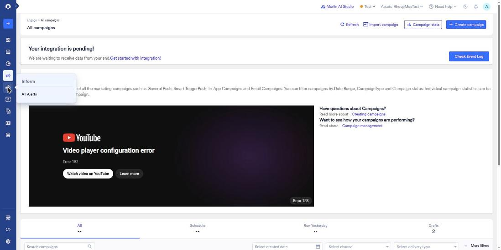
*Sidebar Inform flyout with only 'All Alerts' (no 'New Alert' in this workspace)*

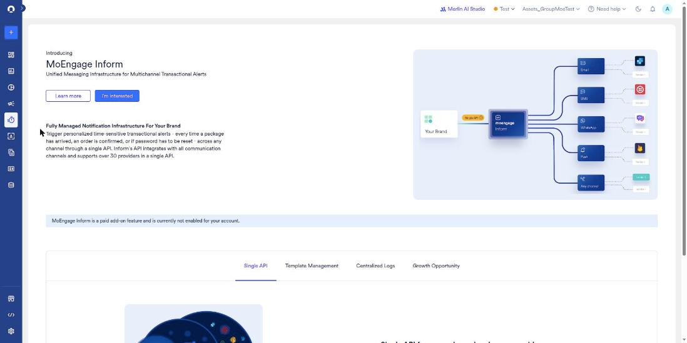
*Inform > All Alerts: 'Introducing MoEngage Inform' promo with Learn more / I'm interested, the multichannel routing diagram and the 'paid add-on ... not enabled' banner*

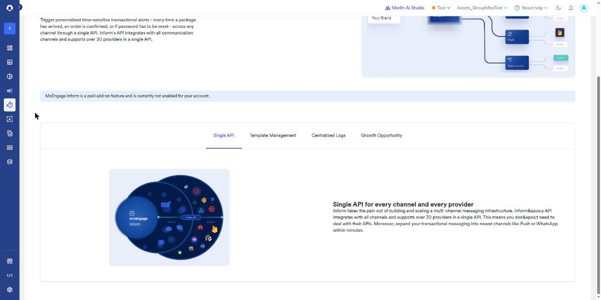
*Promo tab 'Single API': 'Single API for every channel and every provider' (30+ providers, add Push/WhatsApp within minutes)*

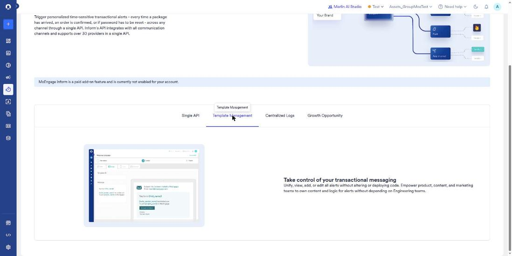
*Promo tab 'Template Management': 'Take control of your transactional messaging' (edit alerts without deploying code), with an email-template editor mock*

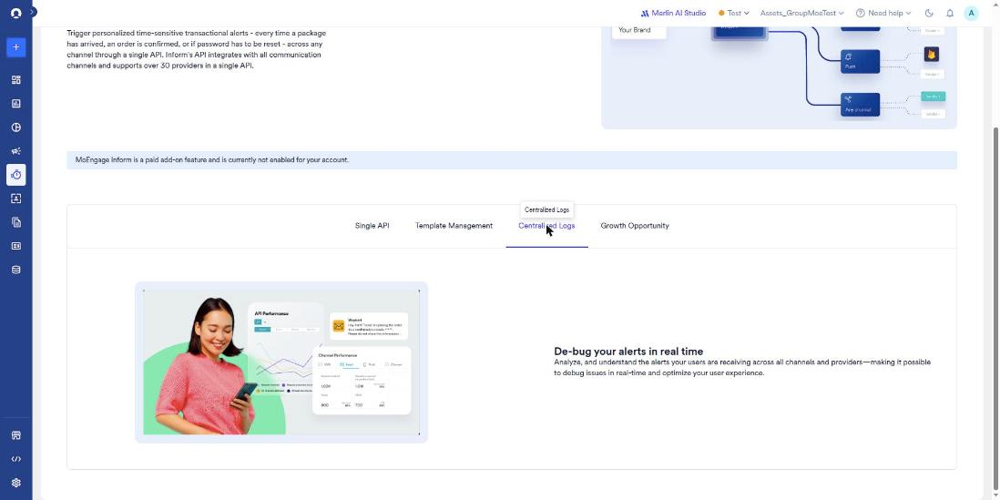
*Promo tab 'Centralized Logs': 'De-bug your alerts in real time', with an API Performance / Channel Performance mock*

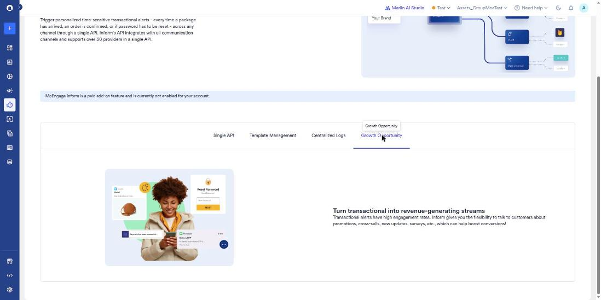
*Promo tab 'Growth Opportunity': 'Turn transactional into revenue-generating streams'*

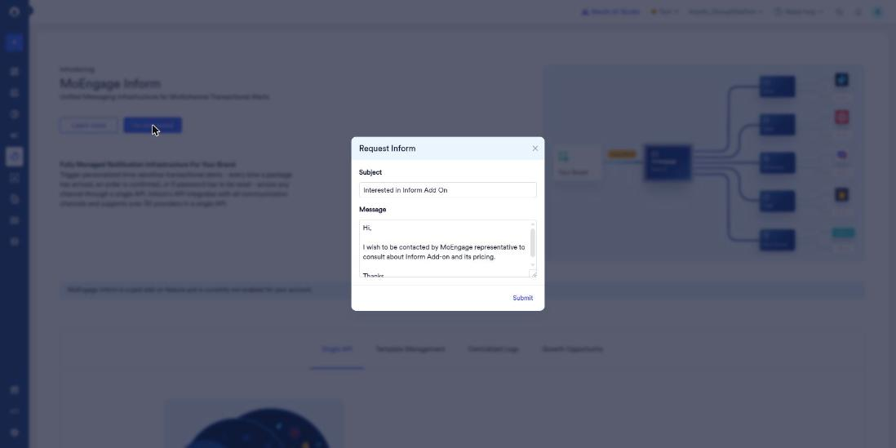
*'Request Inform' modal opened by I'm interested: prefilled Subject and Message plus Submit. Closed with X; Submit not clicked*

#### Inform > New Alert (create-alert route)

*/v4/inform/transaction-alerts/create renders the same Inform promo, so the create-alert wizard is gated*

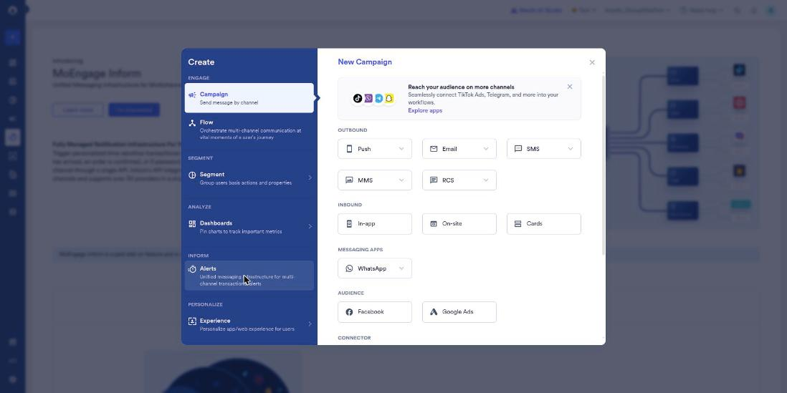
*Create New (+) modal with INFORM > Alerts highlighted (links to /v4/inform/transaction-alerts/create) and PERSONALIZE > Experience*

#### Inform settings (Settings > Miscellaneous > Inform)

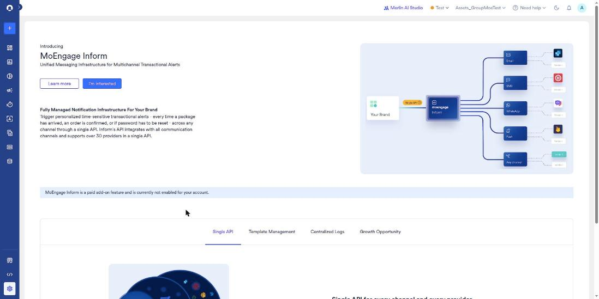
*Settings > Miscellaneous > Inform (/v4/settings-v2/others/informs) also shows the Inform paid add-on promo*

#### Personalize > All Experiences

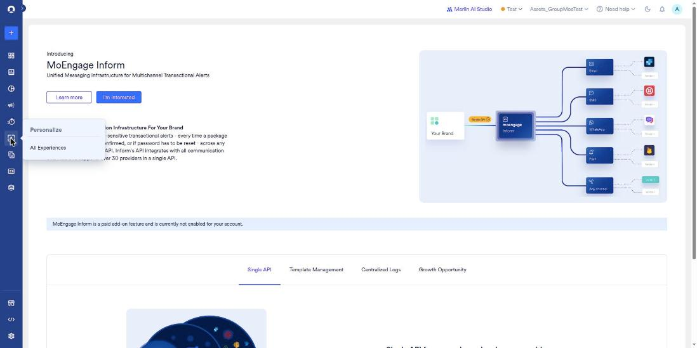
*Sidebar Personalize flyout with only 'All Experiences'*

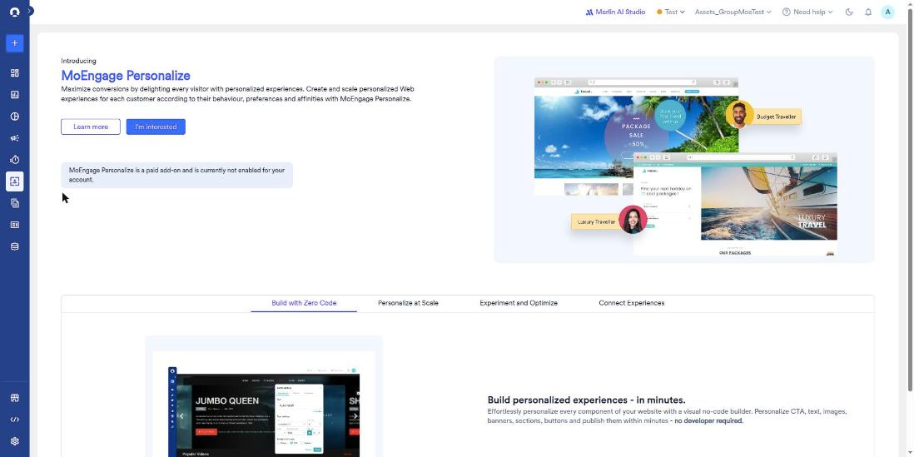
*Personalize > All Experiences: 'Introducing MoEngage Personalize' promo with the paid add-on not-enabled banner and the travel persona mock*

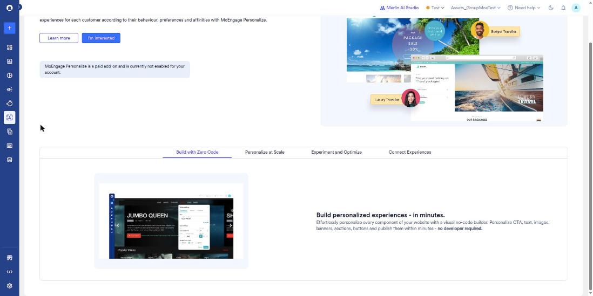
*Promo tab 'Build with Zero Code': 'Build personalized experiences - in minutes.' Visual no-code builder for CTA, text, images, banners, sections and buttons*

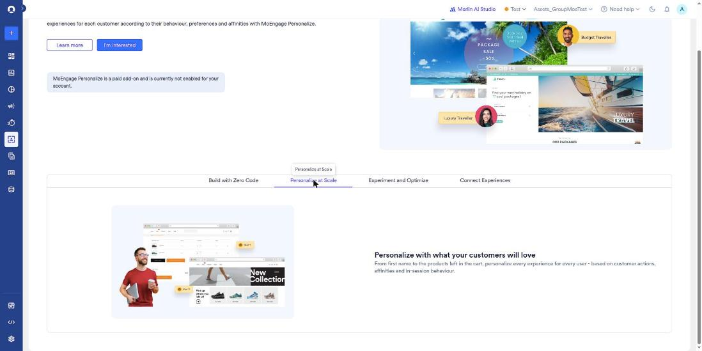
*Promo tab 'Personalize at Scale': personalize on first name, cart products, actions, affinities and in-session behaviour*

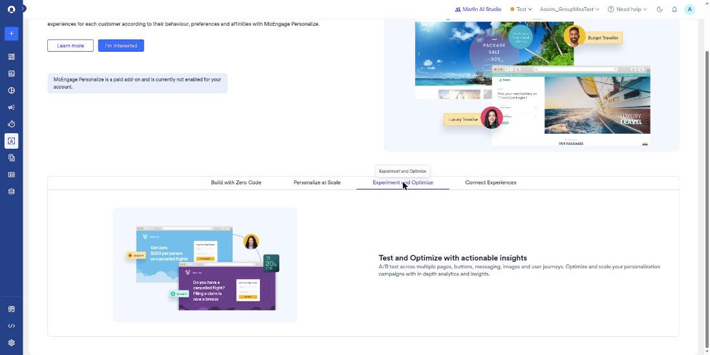
*Promo tab 'Experiment and Optimize': A/B tests across pages, buttons, messaging, images and journeys, with analytics*

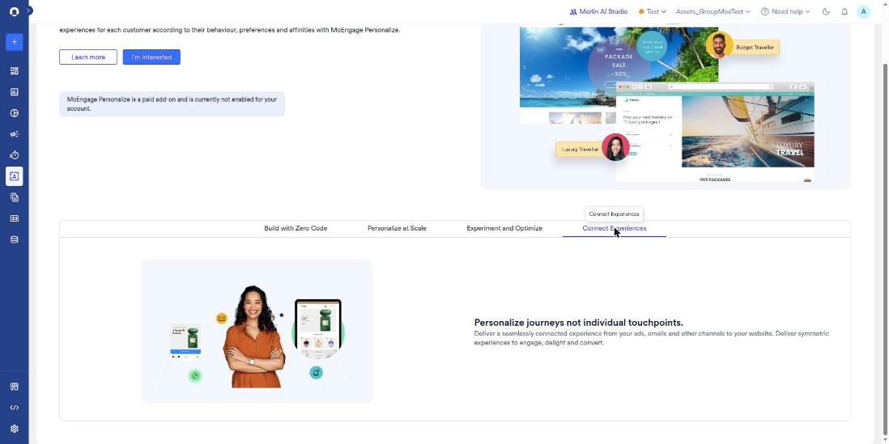
*Promo tab 'Connect Experiences': 'Personalize journeys not individual touchpoints' (ads and emails through to the website)*

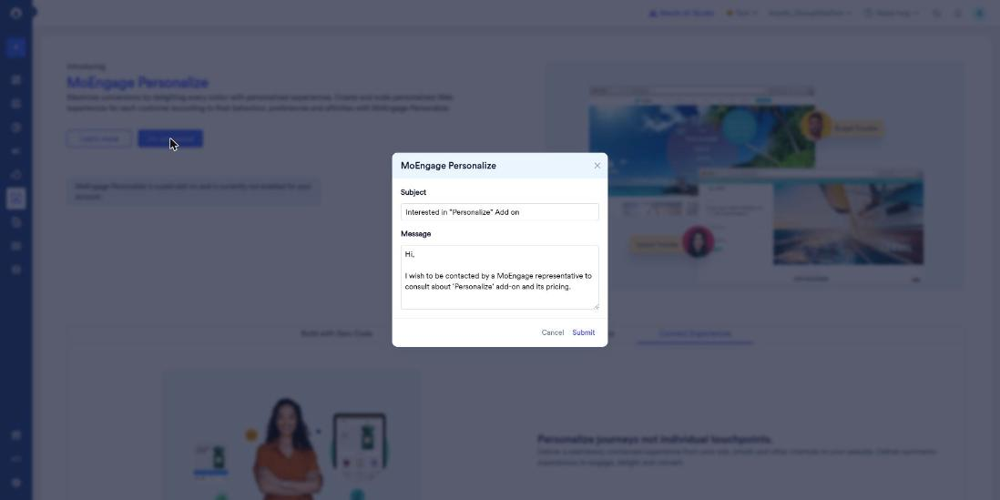
*'MoEngage Personalize' request modal from I'm interested: Subject, Message, Cancel and Submit. Closed with Cancel*

#### Create New (+) > PERSONALIZE > Experience (experience-type picker)

*Create New > PERSONALIZE > Experience: 'New Experience' panel with EXPERIENCE TYPE cards Web (WYSIWYG), Web & App (API), Split URL Testing*

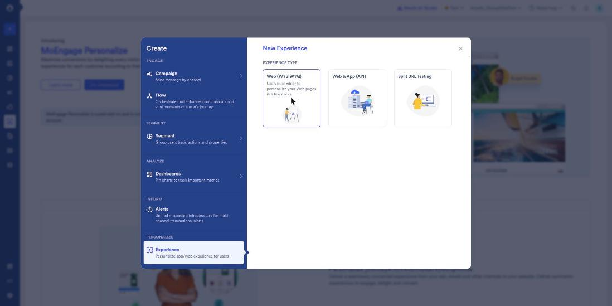
*Hover on Web (WYSIWYG): 'Use Visual Editor to personalize your Web pages in a few clicks'*

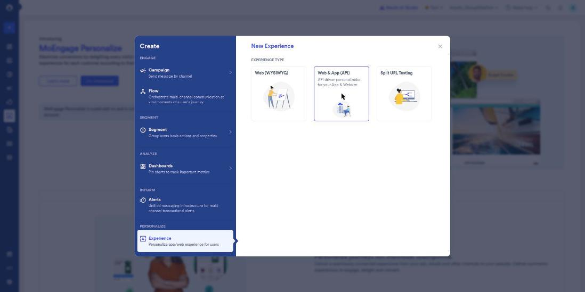
*Hover on Web & App (API): 'API driven personalization for your App & Website'*

*Hover on Split URL Testing: 'Use split URL to divide traffic among your webpages'*

#### Personalize create routes (gated)

No screenshot was saved: all four create routes redirect to `/v4/experience/web` and render the same promo shown under Personalize > All Experiences.
