## 20. Settings > Channels: WhatsApp, Delivery Controls, Preference Management

Storees connects WhatsApp differently from MoEngage and does more once a number is connected: a live-validated Meta Cloud API connection, a one-key Pinnacle connection, an ops-assisted Storees-managed number, template authoring and tracking, a business-profile editor, usage metering, STOP/START handling and an AI chatbot, none of which MoEngage's settings offer. It trails on sender choice (no Embedded Signup, Gupshup hidden from the UI, no Infobip or Karix, one number per project) and on delivery controls. It has only per-channel frequency caps for WhatsApp, SMS and push: no cross-channel cap, quiet hours, cap scope, on-site minimum delay or settings hub, and the email cap is never enforced. The most serious gap is email exclusion (P0). The suppression rule exists, but bounces and complaints are never recorded, campaign and flow emails have no working unsubscribe, flow emails skip the checks entirely, and Shopify unsubscribes aren't honoured.

### MoEngage overview

Module 20 covers three Settings areas.

- **WhatsApp integration settings** has four tabs.
  - **Sender configuration:** a provider list with Meta direct ("New"), Gupshup (username and password), Infobip (base URL and API key) and Karix (API key).
    - Each provider has numbered "Sender N" sub-tabs and a copyable delivery-tracking (DLR) URL to paste into the BSP. Meta also shows a webhook verify token.
    - Meta's intro card describes an embedded sign-up flow, but in this workspace "Add sender" opened a manual Cloud API form, with no Facebook popup.
  - **Approved templates:** an empty state until a sender exists.
  - **General settings:**
    - Pickers for the attributes that hold the WhatsApp number and the opt-in.
    - The rule "send unless opt-in is FALSE", with a per-campaign override.
    - Two inbound toggles: create profiles from new numbers (CTWA leads), and store every inbound message as a "WhatsApp message Received" event.
  - **Data:** PII tokenization, locked behind the CSM.
- **Delivery controls** has four tabs.
  - **Frequency capping:**
    - A cross-channel cap that overrides the channel rules.
    - Per-channel caps for Push, SMS, Email, WhatsApp and Connector, each scoped by delivery type, with "+" for extra rules.
    - A daily 00:00 refresh in the app or user time zone.
  - **Do not disturb:** per-channel quiet hours in the user's time zone. Messages generated during DND can be discarded or queued, released LIFO or FIFO, with a gap between them. It covers triggered sends and flows only.
  - **Throttling:** a default per-minute speed per channel for one-time and periodic campaigns, showing max, min and default (WhatsApp 200,000 / 10,000 / 60,000).
  - **Minimum delay:** 15 minutes between two in-app messages and between two on-site messages, on by default.
  - Capping, DND and throttling were all off. There is no message-priority setting anywhere.
- **Preference management** is a stub. It has one EMAIL tab saying blocks, unsubscribes and complaints are never emailed, plus a tooltip. There is no preference centre, no subscription categories and no double opt-in; email categories are under Settings > Email (module 19).

**Capture caveats:** the Test workspace had no WhatsApp sender. Approved templates showed only the empty state, and the General settings controls were disabled. Option lists of disabled dropdowns were read from React props. Nothing was saved, toggled, connected or sent.

| Page visited | URL path |
|---|---|
| WhatsApp integration settings: Sender configuration | `/v4/whatsapp/settings/sender-configuration` (`/v4/whatsapp/settings/` redirects here) |
| WhatsApp integration settings: Approved templates | `/v4/whatsapp/settings/approved-templates` |
| WhatsApp integration settings: General settings | `/v4/whatsapp/settings/general-settings` |
| WhatsApp integration settings: Data | `/v4/whatsapp/settings/data` |
| Delivery controls: Frequency capping | `/v4/settings-v2/channels/delivery-controls/fc` (`/delivery-controls` redirects here) |
| Delivery controls: Do not disturb | `/v4/settings-v2/channels/delivery-controls/dnd` |
| Delivery controls: Throttling | `/v4/settings-v2/channels/delivery-controls/throttling` |
| Delivery controls: Minimum delay | `/v4/settings-v2/channels/delivery-controls/minimum-delay` |
| Preference management | `/v4/settings-v2/channels/preference-management` |

### Storees counterpart

- **WhatsApp:** Settings > SDK & Integration > Channels > WhatsApp (`/settings`).
  - Channels and WhatsApp are the default section and channel. Both are held in local state, so the page can't be linked to directly (`packages/frontend/src/app/(dashboard)/settings/page.tsx:57,410`).
  - The tab renders two panels (`settings/page.tsx:500-504`):
    - `settings/WhatsappChannelPanel.tsx`: a status header, then Connection cards for Storees managed, WhatsApp Cloud API and Pinnacle. Business Profile follows for Meta numbers, then Usage.
    - `settings/WhatsappChatbotPanel.tsx`.
  - Backend:
    - `packages/backend/src/routes/whatsappAdmin.ts`: connect-meta, connect-pinnacle, provisioning, profile, usage, templates and chatbot config.
    - `services/whatsappMetaConnectService.ts`.
    - `services/providers/index.ts`: six WhatsApp providers (twilio, gupshup, bird, vonage, meta, pinnacle).
    - `services/channelProviderRegistry.ts`: one config per project.
    - `routes/channelWebhooks.ts`: delivery receipts and inbound messages.
    - `services/whatsappInboundService.ts`.
  - Related pages:
    - `/templates?channel=whatsapp` (`templates/page.tsx` and `components/whatsapp/WhatsAppTemplateBuilder.tsx`). `/whatsapp-templates` redirects there.
    - `/inbox`, `/campaigns/ctwa` and `/widgets` (the last is not in the sidebar).
    - `/whatsapp-provisioning`, the platform-admin queue.
- **Delivery controls:**
  - The "Frequency caps" card on Settings > Project (`settings/project/page.tsx:114-200`).
    - API: `GET/PATCH /api/onboarding/projects/:id/frequency-caps` (`routes/v1Onboarding.ts:784-850`).
    - Enforced in `services/deliveryService.ts:79-125,431-457` for promotional SMS, push and WhatsApp.
  - The "Delivery Controls" block in campaign step 3: ignore the cap, count toward the cap, and a request limit (`campaigns/create/page.tsx:3516-3556`, `campaigns/[id]/edit/page.tsx:1756-1784`). The request limit is enforced by `campaignService.ts:801-804,1079-1099`.
  - There is no DND, cross-channel cap, project-level throttling default or minimum delay.
- **Preferences:** there is no settings page (`settings/layout.tsx:12-27`). Email exclusion is backend-only:
  - Campaign staging drops addresses in `email_suppressions` and customers with an email `opted_out` consent (`services/campaignService.ts:588-622`).
  - Suppressions are written only by `routes/resendWebhook.ts` and `services/unsubscribeService.ts:94`.
  - The public unsubscribe page is `routes/unsubscribe.ts`.
  - Consents and their audit log live in `services/consentService.ts`.
  - The per-customer Consent tab is read-only (`components/customers/ConsentTab.tsx`).

### Parity table

| Area | Feature | MoEngage | Storees | Evidence | Gap / recommendation | Priority | Effort |
|---|---|---|---|---|---|---|---|
| WhatsApp > Sender configuration | Meta direct (Cloud API) sender with own credentials | "Add sender" opened a manual "Sender 1" form: sender name, number, API key, App ID, number ID and business account ID, plus a copyable verify token and DLR URL. No validation is shown | ✅ Full | `MetaConnect.tsx:38-205` → `POST /api/whatsapp/connect-meta` (`whatsappAdmin.ts:772-788`) → `linkMetaWhatsappAccount` (`whatsappMetaConnectService.ts:64-153`). It checks the token against the number, encrypts it, calls `subscribed_apps`, saves the config and imports templates | Three fields instead of six, validated live. Small gaps: there is no App ID field, so profile-photo upload for a BYO number falls back to Storees' `META_APP_ID` (`whatsappProfileService.ts:50,113-124`). The quality rating fetched on connect is never shown. The card shows the number only right after connecting (`MetaConnect.tsx:97-110`). Webhook routing is covered in the delivery-tracking row. | — | — |
| WhatsApp > Sender configuration | Meta Embedded Signup (self-serve WABA creation) | Intro card: the embedded sign-up flow "will guide you through your WhatsApp and MoEngage integration" and creates a WABA if needed. In this workspace "Add sender" showed the manual form | ❌ Missing | No `FB.login`, `fbAsyncInit`, `connect.facebook.net` or `config_id` in any package. Flagged as Phase 5, pending Meta Tech Provider approval (`docs/META_WHATSAPP_BUILD_PLAN.md:79-89`). The alternative is the ops-assisted "Storees managed" intake (`StoreesProvisioning.tsx`; `whatsappAdmin.ts:796-955`) | A merchant without a WABA waits for Storees ops. BYO needs Business Manager know-how and a system-user token, a common drop-off point. Build Embedded Signup on `linkMetaWhatsappAccount` and `registerWhatsappNumber` once Tech Provider status is approved. It also fixes webhook routing for brand-owned numbers. | P1 | M |
| WhatsApp > Sender configuration | Gupshup sender | "Sender 1": sender name, number, username and password (Gupshup Enterprise), plus a copyable `/whatsapp/gupshup/dlr` URL | 🟡 Partial | Backend only. Registered at `providers/index.ts:33`. `gupshupProvider.ts:85-224` sends templates and session text via api.gupshup.io (API key, app name and source number), parses inbound and syncs templates (needs `appId`); there is no `submitTemplate`. Receipts and inbound arrive at `/api/webhooks/channel/gupshup` (`channelWebhooks.ts:86-125`). The panel offers only Storees managed, Cloud API and Pinnacle (`WhatsappChannelPanel.tsx:18-22`). The Gupshup form at `settings/page.tsx:389-390` never renders for WhatsApp (:500-504) | Brands already on Gupshup can't connect from the UI. Expose it in the panel with the `appId` that template sync needs and the webhook URL to paste. Gupshup Enterprise username/password accounts (what MoEngage asks for) aren't supported, and templates can't be submitted through Gupshup. | P1 | S |
| WhatsApp > Sender configuration | Infobip sender | Form: sender name, number, API base URL, API key and the `/whatsapp/infobip/dlr` URL | ❌ Missing | No "infobip" anywhere in `packages/`. WhatsApp providers are a fixed list (`providers/index.ts:32-37`) | Brands on Infobip can't connect. It needs a new provider: template send, session text, an inbound and receipt webhook, and template sync. | P2 | M |
| WhatsApp > Sender configuration | Karix sender | Form: sender name, number, API key (show/hide) and the `/whatsapp/karix/dlr` URL | ❌ Missing | No "karix" or "tanla" anywhere in `packages/` | Karix (Tanla) serves mostly Indian enterprise and BFSI brands, so it matters little for Shopify D2C. | P3 | M |
| WhatsApp > Sender configuration | Multiple named senders per provider | Numbered "Sender 1" sub-tabs, each with a sender name, so a workspace can hold several numbers per BSP | ❌ Missing | One config per project at `settings.channels.whatsapp`, overwritten on every connect (`whatsappMetaConnectService.ts:116-127`; `whatsappAdmin.ts:1093-1099`). `getChannelProvider` returns that single config (`channelProviderRegistry.ts:169-202`). A Pinnacle key that owns several numbers forces a single pick (`PinnacleConnect.tsx:156-175`) | A project can't run separate marketing and support numbers or numbers per brand or region, and can't choose the sender per campaign or flow. The workaround is one project per number. | P3 | L |
| WhatsApp > Sender configuration | Delivery tracking (DLR) webhook setup | Every provider form has "Enable delivery tracking" with a copyable MoEngage DLR URL. Meta also shows a static verify token to paste into Meta | 🟡 Partial | **Pinnacle:** the webhook is registered automatically with a per-project secret (`whatsappAdmin.ts:1066-1090`), checked at `channelWebhooks.ts:370-397`. **Meta:** `subscribed_apps` is called without `override_callback_uri` (`whatsappMetaConnectService.ts:101-114`). GET verification uses the platform `WA_VERIFY_TOKEN` (`channelWebhooks.ts:240-250`), and no screen shows the callback URL or token. A health line reads "Delivery tracking active/inactive" (`MetaConnect.tsx:111-116`, `PinnacleConnect.tsx:106-111`) | Automatic registration beats copy-paste for Pinnacle and Storees-managed numbers. For a BYO Meta app, `subscribed_apps` subscribes the brand's own app, whose callback URL Storees never sets or shows. Receipts, replies and STOP may therefore never arrive while the card says tracking is active (read from code, not run). Pass `override_callback_uri` with a per-project verify token, or show both for copy, and show the URLs for the backend-only BSPs. Also, POST callbacks from Meta, Gupshup, Twilio, Bird and Vonage are accepted without any signature check (only Pinnacle checks a secret), so a forged inbound "STOP" or "START" can flip a customer's WhatsApp consent. | P1 | S |
| WhatsApp > Approved templates | Approved templates library (gated on sender) | Lists templates per sender. With no sender, only an empty state with "+ Configure sender"; the list, sync and add-template UI couldn't be seen | ⭐ Storees better | `/templates?channel=whatsapp` (`templates/page.tsx:107-241`): cards or table, search, "Sync from provider" and "New WhatsApp Template". `WhatsAppTemplateBuilder.tsx` saves drafts without a provider and explains why Submit is disabled (:178,566-577). Create, lint, submit, edit, refresh and test-send routes are at `whatsappAdmin.ts:88-660`, with real `submitTemplate` for Meta and Pinnacle. An hourly sync and a 4-hourly status poll run alongside webhooks (`templateStatusWorker.ts:24-30`). Statuses run from DRAFT to DISABLED, including IN_APPEAL, FLAGGED and PAUSED (`types.ts:1150-1152`). Admins get an email when Meta re-categorises a template (`templateAlertService.ts`) | Ahead: Storees authors, lints, submits and tracks templates instead of only listing approved ones. Smaller gaps: no delete or archive (no DELETE route), no category or status filter, no "where used" view, and the library sits under Templates rather than next to the sender. | — | — |
| WhatsApp > General settings | Attribute that holds the WhatsApp number | Picker "Select the attribute in which user's WhatsApp mobile number is stored" (default Mobile Number (Standard)), with standard and custom attributes grouped | 🟡 Partial | Fixed to `customers.phone`, the same default MoEngage ships. Reachability (`deliveryService.ts:459-491`), staging (`campaignService.ts:576-585`) and sends all read it. There is no setting (searched whatsapp_number, whatsappPhone, phoneAttribute, phone_field). Shopify fills it only from `customer.phone` (`syncWorker.ts:173-183`; `eventProcessor.ts:282,313`), never from the address, shipping, billing or checkout phone | Brands can't point WhatsApp at another attribute, such as a custom `whatsapp_number` or the checkout phone. On Indian Shopify stores, where shoppers often give a phone only at checkout or in the address, many customers look unreachable on WhatsApp. Add an address and checkout phone fallback at ingestion, plus a project-level number source used by reachability and sends. | P1 | M |
| WhatsApp > General settings | Attribute that holds the WhatsApp opt-in | Picker "Select the attribute in which user's WhatsApp Opt-In is stored" (default WhatsApp Subscription Status) | 🟡 Partial | Opt-in lives in a fixed `consents` table keyed by channel and purpose (`deliveryService.ts:347-385`; `consentService.ts:21-104`). It is written by STOP/START, CTWA, widgets, unsubscribe and the consent API. `customers.whatsapp_subscribed` (`schema.ts:147`) can be set through `/api/v1` (`v1Events.ts:582-652`), but the send gate never reads it | An opt-in imported as a profile attribute has no effect unless it is also written as a consents row, and no attribute can be mapped. The customer Consent tab reads the flag, not the gate: it shows WhatsApp "Opted out" whenever `whatsapp_subscribed` is false, the default, even though sends go out (`ConsentTab.tsx`; `consentService.ts:112-131`). STOP/START changes skip the consent audit log (`whatsappInboundService.ts:295-356`). Add an opt-in source setting or sync the flag into consents, and show the effective status. | P2 | S |
| WhatsApp > General settings | Opt-in sending rule with per-campaign override | "Messages will be sent to users for whom selected Opt-in property value is not FALSE"; sending to FALSE can be enabled during campaign creation | 🟡 Partial | Same default: marketing is allowed unless an explicit `opted_out` consents row exists (`deliveryService.ts:369-381`), and blocked sends are recorded as `consent_blocked` (:89-91). No campaign option includes opted-out users (searched ignoreConsent, bypassConsent, includeOptedOut). The builder has only a subscription-category picker and opt-out counts (`campaigns/create/page.tsx:1177-1185,1446-1451`) | The default rule matches. Missing: the per-campaign override (rarely advisable; if added, limit it to UTILITY/AUTH templates and admins) and any on-page explanation of the rule. | P3 | S |
| WhatsApp > General settings | Create a profile when a new number messages (lead capture) | Toggle "Create a new user profile if message is received from new number": leads from inbound messages, CTWA measurement, retargeting | 🟡 Partial | A profile is created only when the first inbound message carries a Click-to-WhatsApp referral (`whatsappInboundService.ts:114-122,184-290`: attribution row, implicit opt-in, `ctwa_lead_received`). Other unknown numbers are stored with `customer_id` null (:124-135). The chatbot's "Answer unknown numbers" option replies without creating a profile (`whatsappChatbotService.ts:120`; `WhatsappChatbotPanel.tsx:99`). There is no toggle | Organic inbound leads (website chat buttons, QR codes, "Hi" messages) never become profiles, so they can't be segmented, attributed or retargeted. Add a setting that calls `resolveCustomer` for any new number, with source `whatsapp_inbound`. | P2 | S |
| WhatsApp > General settings | Store all incoming messages as an event | Toggle "Store all incoming messages from all customers" saves them as the event "WhatsApp message Received" on the user profile | 🟡 Partial | Always on for matched customers. Every inbound message from Meta, Pinnacle, Gupshup, Twilio, Bird or Vonage goes to `whatsapp_inbound_messages` and a `whatsapp_inbound` event (`whatsappInboundService.ts:124-160`). The event is inserted straight into `events` and never published to the events queue (only CTWA leads are, :277), and `triggerWorker.ts` reads only the queue | The event works in segments, the timeline and flow Condition nodes (`flowExecutor.ts:473-495`), but a reply can't start a flow or act as a flow exit (e.g. "stop the cart reminders when the customer replies"). Messages from unknown numbers are kept but not on any profile. There's no switch to stop storing message bodies, which a DPDP data-minimisation request might need. Publish the event to the queue. | P2 | S |
| WhatsApp > Data | PII tokenization | Keeps PII in a secure environment and sends with tokens. Locked: "contact your Customer Success Manager" | ❌ Missing | No tokenization or vault code (searched tokeniz, detokeniz, vault). Related controls only: role-based masking of email and phone in API responses (`lib/pii.ts`; `middleware/capabilities.ts`), and an ingestion guard that rejects card and Aadhaar numbers (`middleware/dataMasking.ts`). `customers.phone` is stored in plaintext | An enterprise and BFSI security ask, of little relevance to Shopify D2C. | P3 | XL |
| WhatsApp > Settings tabs | Hidden fourth WhatsApp settings tab (id 4) | The tab component's props include an id-4 tab that is filtered out for this workspace. Guessed routes redirect to sender-configuration | ➖ N/A | The tab's content is unknown, so there is nothing to compare. For reference, Storees handles STOP/START keywords in code with no settings UI (`whatsappInboundService.ts:10-20`) | Re-check if the tab is identified later. | — | — |
| Delivery controls | Delivery controls hub (Frequency capping / DND / Throttling / Minimum delay) | One page with four card tabs; each opens with a banner on which campaign types it doesn't cover | 🟡 Partial | The only global control is the "Frequency caps" card at the bottom of Settings > Project (`settings/project/page.tsx:107-110,114-200`). Per campaign, step 3 "Delivery Controls" has ignore cap, count toward cap and a request limit (`campaigns/create/page.tsx:3516-3556`; `campaigns/[id]/edit/page.tsx:1756-1784`) | No single place to see or explain sending rules, and no DND, throttling defaults or minimum delay. Add Settings > Delivery controls and move frequency caps there. | P2 | S |
| Delivery controls > Frequency capping | Cross-channel frequency cap | "All channels": "Send a maximum of N Communication from all campaigns/flows to a user in N day(s)", overriding channel rules (defaults 0 and 7 days; off) | ❌ Missing | Per-channel keys only: `whatsapp_marketing`, `sms_marketing`, `email_marketing`, `push_marketing` (`v1Onboarding.ts:784-806`). `checkFrequencyCap` counts one channel (`deliveryService.ts:431-457`). No email creates a `messages` row (only `deliveryService.ts:499` inserts them), so even a cross-channel count would miss email | A customer can hit the WhatsApp, SMS, email and push maximums all in the same week. Add an all-channels rule to the send gate once email sends are recorded. | P1 | M |
| Delivery controls > Frequency capping | Per-channel caps for WhatsApp, SMS and Push | Rows for Push, SMS and WhatsApp: a toggle plus "Send a maximum of N <channel> [scope] to a user in N day(s)". Not applied to Alerts; all off by default | ✅ Full | Settings > Project > Frequency caps: max 0-100 per 1-90 days (`settings/project/page.tsx:114-200`; `v1Onboarding.ts:784-850`). On by default: WhatsApp 1 per 7 days, SMS 3 per 7, push 5 per day (`schema.ts:63-68`). Enforced on promotional SMS, push and WhatsApp in campaigns and flows (`deliveryService.ts:79-100,431-457`). Transactional sends and UTILITY/AUTH templates bypass it (:37-43,82). Campaigns have ignore/count toggles. Blocked sends are recorded as `frequency_capped` and counted in the preview | Parity for these three channels; the email, scope and multi-rule gaps are separate rows. The window is rolling rather than a daily reset. Dealer-directed sends are logged against the customer and count toward the customer's cap (`deliveryService.ts:52-68`). | — | — |
| Delivery controls > Frequency capping | Email frequency cap | Email row: "Send a maximum of N Email [all / one time/periodic / event triggered / flows / API triggered] to a user in N day(s)" | ❌ Missing | The setting exists (`settings/project/page.tsx:121`; default 3 per day, `schema.ts:66`). But campaign and flow emails call `sendEmail` directly (`campaignService.ts:993`; `flowExecutor.ts:750`): they never pass the send gate and never create `messages` rows. The cap check and the preview both count `messages` (`deliveryService.ts:431-457`; `campaignService.ts:336-353`), so no email is ever capped and the preview always shows 0 for email | The email cap and the campaign "Count toward frequency capping" toggle are cosmetic: merchants see "3 per day", but no email is counted or blocked. Record email sends and apply the cap at staging and in flows; until then, label the row as not enforced. | P1 | M |
| Delivery controls > Frequency capping | Cap scope by delivery type | Each channel cap has a "Delivery Type" scope: all campaigns, one time/periodic, event triggered, device triggered, flows, location triggered, push API / API triggered | ❌ Missing | `checkFrequencyCap` counts every promotional message on the channel whatever its source (`deliveryService.ts:431-457`), even though `messages` carries `flow_trip_id` and `campaign_id` (:509-510). Flow sends are always "promotional" with no cap flags (`flowExecutor.ts:796-806`), and the flow action node has no cap options | Caps can't be limited to broadcasts. With the default WhatsApp cap of 1 per 7 days, a MARKETING broadcast silently blocks a MARKETING-category abandoned-cart message for a week, and the reverse. Add a scope (campaigns / flows / all) to each rule, plus ignore/count options on flow send nodes. | P1 | S |
| Delivery controls > Frequency capping | Multiple cap rules per channel ("+") | A "+" on each channel row adds another rule, e.g. one per day and one per week | ❌ Missing | `frequency_caps` holds one `{perDays, max}` per channel key (`schema.ts:63-68`; `v1Onboarding.ts:784-806`; `deliveryService.ts:431-440`) | A daily and a weekly ceiling can't be combined on one channel. | P3 | S |
| Delivery controls > Frequency capping | Connector channel caps (and Connectors in throttling and DND) | Connector row ("Connector request") with its own scopes. Connectors also appear in Throttling and as "SMS & Connectors" in DND | ➖ N/A | Storees has no connector campaign channel. Outbound calls exist only as the flow `http_request` node (`shared/src/types.ts:734`) and outbound webhooks, which aren't customer messages | None. Revisit only if a connector channel is added. | — | — |
| Delivery controls > Frequency capping | Cap refresh time and time zone | "Refresh the frequency capping daily at 00:00 [App time zone \| User time zone]" | ❌ Missing | Caps use a rolling window, `NOW() - perDays days` (`deliveryService.ts:453`). There is no project time zone: fixed-time flows run in UTC (`flowFixedTimeScheduler.ts:24-29`) | "Per day" means the last 24 hours, not the customer's calendar day. Rolling windows are a reasonable default, so this is low priority. | P3 | S |
| Delivery controls > Do not disturb | Channel-wise quiet hours (DND) in the user's time zone | Rows for Push, SMS & Connectors, Email and WhatsApp, each with a toggle and From/To hh:mm am/pm in the user's time zone. Covers triggered sends and flows, not One-time, Periodic or API-triggered campaigns | ❌ Missing | Only a docstring mentions quiet hours (`deliveryService.ts:27`); the gate is consent, cap, reachability, plan, then queue (:79-125). Nothing for quietHours, dnd, sendWindow, businessHours, timeWindow or blackout. Flow delays are fixed durations (`shared/src/types.ts:637-641`). Reusable pieces: the customer time zone from `customAttributes.timezone` and `nextLocalDateTime` (`campaignService.ts:1141-1166`) | Abandoned-cart and browse flows send WhatsApp and SMS at 2 a.m. in the customer's time zone, which annoys shoppers and can hurt the WhatsApp quality rating. Add per-channel quiet hours that push the BullMQ delivery job to the end of the window, using the customer's time zone when known and a new project time zone otherwise. | P1 | M |
| Delivery controls > Do not disturb | Handling of messages generated during DND | Action: discard / save and send all (default) / one per campaign / one across the channel. Order: LIFO (default) or FIFO. Gap between messages: N minutes (default 5) | ❌ Missing | Storees has no DND, so there is no queue policy (`deliveryService.ts:79-125`) | Once quiet hours exist, the morning burst of queued messages needs collapsing and spacing so a customer doesn't get several messages at 9 a.m. | P2 | M |
| Delivery controls > Throttling | Default campaign send speed per channel | "Limit to N <X> per minute" per channel, used as the default for one-time/periodic campaigns and editable per campaign. Helper text shows max/min/default (WhatsApp 200,000 / 10,000 / 60,000) | 🟡 Partial | Per-campaign "Request limit: Limit to N requests per minute" (`campaigns/create/page.tsx:3548-3554`; `[id]/edit/page.tsx:1784`), enforced by `campaignService.ts:801-804,1079-1099`. There is no project default per channel. The delivery worker sends SMS, WhatsApp and push at most 50 per second, shared by all tenants (`deliveryWorker.ts:33-38`). `projects.email_rate_per_minute` (`schema.ts:59`) applies only to email jobs on the delivery queue, and none are ever queued, so it limits nothing | There's no default send speed per channel, and the create page's 60000-per-minute placeholder is far above the real ceiling of about 3,000 WhatsApp/SMS/push messages per minute across all tenants. Add per-channel defaults that prefill the campaign field, and show the real ceiling. | P2 | S |
| Delivery controls > Minimum delay | Minimum delay between two in-app messages | Inapp: on, "Set minimum delay of 15 Minutes between two Inapp notifications" (Minutes is the only unit) | ❌ Missing | In-app is a pull API with a per-message frequency of once, daily or always (`v1InAppMessages.ts:140-150`; `schema.ts:564`). There's no gap between different messages, and neither SDK renders in-app messages (no in-app code in `packages/sdk/src` or `packages/sdk-react/src`) | This depends on building an in-app renderer first; add a global gap when it ships. | P3 | S |
| Delivery controls > Minimum delay | Minimum delay between two on-site messages | On site messaging: on, 15 Minutes between two on-site messages | ❌ Missing | On-site opt-in widgets are limited per widget only: `showOnce` in localStorage and a per-widget DOM check (`sdk/src/widget.ts:137-152,167-168`). Every active widget's trigger is armed (:50-66), and there's no project-level gap (`routes/optinWidgets.ts`) | Exit-intent, time-on-page and scroll-depth widgets can stack in one visit. Add a project-level minimum gap enforced in the SDK. | P2 | S |
| Delivery controls | Message priority control | Absent: no campaign priority or conflict resolution on any Delivery controls tab | ➖ N/A | Neither product has it. Storees has no priority field on campaigns, flows or messages (`schema.ts`, `shared/src/types.ts`) | Parity: both lack it. | — | — |
| Preference management | Default exclusion of email blocks, unsubscribes and complaints | EMAIL tab: "By default we do not send emails to Blocks, unsubscribes and complains." Tooltip: "This will help you to exclude opted-out users from future campaigns" | 🟡 Partial | Campaign staging drops `email_suppressions` and email `opted_out` consents (`campaignService.ts:588-622`). But: (1) the Resend webhook finds the project only through a `messages` row (`resendWebhook.ts:108-115,202-228`), and no email creates one, so bounces and complaints are never suppressed. (2) `{{unsubscribe_url}}` resolves to empty in campaign and flow emails (`campaignService.ts:935`; `templateContext.ts:113-120`). List-Unsubscribe is set only by `resendProvider.ts:83-101`, which no customer email path uses. (3) Flow emails skip the suppression and consent checks (`flowExecutor.ts:737-751`; `emailService.ts:32-90`). (4) Shopify unsubscribes land in `email_subscribed`, which no send checks (`deliveryService.ts:375-381`). (5) Only Resend sends webhooks | The rule exists, but almost nothing feeds it. Complainers, hard bounces and Shopify unsubscribes keep getting campaign email, flows email known unsubscribes, and recipients have no working way to unsubscribe. That is a deliverability and legal risk (Gmail/Yahoo bulk-sender rules, CAN-SPAM, DPDP), with the same root cause as the P0s in modules 01 and 02. Fix: resolve the project from `campaign_sends.resend_message_id`, record flow email sends, apply suppression and consent in the flow path, mint unsubscribe tokens in `sendEmail`, and mirror Shopify unsubscribes into consents. | P0 | M |
| Preference management | Preference management settings page | A Settings page with one EMAIL tab (lock illustration plus the exclusion statement) and an info tooltip. No preference centre, categories or double opt-in here | ❌ Missing | Settings has no preferences or suppression page (`settings/layout.tsx:12-27`). No API or UI lists or removes `email_suppressions` (written only by `resendWebhook.ts` and `unsubscribeService.ts:94`). The customer Consent tab is read-only (`ConsentTab.tsx`) | Admins can't see which addresses are excluded or why. Add a Preferences & suppression page: default rules per channel (email suppressions, WhatsApp STOP, SMS), plus a searchable suppression list with remove. | P3 | S |

### Storees-only strengths

- **Storees-managed WhatsApp number (ops-assisted provisioning).**
  - Where: the intake form and status in `settings/StoreesProvisioning.tsx`; intake, status, Cloud API registration with a 2-step PIN, and linking in `routes/whatsappAdmin.ts:796-955`; the platform queue at `/whatsapp-provisioning`.
  - Why it matters: a brand with no WABA or BSP gets a live number without touching Meta Business Manager. MoEngage's settings assume the brand already has a BSP or Meta account.
  - Caveat: the ops-only form is shown to merchants (see UX notes).
- **Validation, webhook registration and template import when a provider connects.**
  - Meta: a Graph API check, `subscribed_apps` and template import (`whatsappMetaConnectService.ts:64-153`).
  - Pinnacle: one key, number discovery and a picker, a per-project webhook secret and `setwebhook` (`whatsappAdmin.ts:1022-1126`).
  - A health line on the connected card (`MetaConnect.tsx:111-116`, `PinnacleConnect.tsx:106-111`).
  - This means fewer setup mistakes than MoEngage's copy-paste DLR URLs. Caveat: BYO Meta webhook routing (see the delivery-tracking row).
- **WhatsApp Business Profile editor** (`WhatsappProfile.tsx`; `whatsappAdmin.ts:978-1020`; `whatsappProfileService.ts`). Brands edit the photo, about, address, description, websites and vertical their customers see. Meta numbers only. MoEngage's WhatsApp settings have nothing similar.
- **WhatsApp conversation usage and estimated spend** (`WhatsappUsage.tsx`; `whatsappAdmin.ts:962-973`; `whatsappUsageService.ts`). Billable conversations are split into Marketing, Utility, Authentication and Service, with a cost estimate. Only Meta webhooks feed it (`channelWebhooks.ts:301-306`), so it stays empty for Pinnacle.
- **AI WhatsApp chatbot with human handoff, plus a shared Inbox** (`WhatsappChatbotPanel.tsx`; `whatsappChatbotService.ts:97-183`; `/inbox`; `routes/whatsappInbox.ts`). It answers inbound FAQ, order-status and product questions and hands off to agents; MoEngage's inbound settings only store messages. Caveats:
  - It needs the `ai_chatbot` plan feature.
  - Pinnacle can't send the replies (no `sendSessionText`).
  - Inbox threads exist only while the chatbot is on.
- **Automatic STOP/START keyword handling** (`whatsappInboundService.ts:10-20,163-167,295-356`). STOP/UNSUBSCRIBE/OPT OUT opts the customer out of WhatsApp, and START/YES opts them back in, with `whatsapp_opted_out` and `whatsapp_opted_in` events. Caveats:
  - Matched customers only.
  - No consent audit-log entry.
  - The 5-minute consent cache (`deliveryService.ts:353-383`) isn't cleared.
- **Click-to-WhatsApp lead capture with implicit opt-in** (`whatsappInboundService.ts:184-290`; `/campaigns/ctwa`; `whatsappAdmin.ts:670-751`). Ad leads become profiles, the ad context is stored as consent text, and `ctwa_lead_received` can start a welcome flow. Caveat: the per-ad converted and revenue columns are read but never written.
- **Frequency caps that follow the WhatsApp template category** (`deliveryService.ts:30-43,82`). UTILITY and AUTHENTICATION templates are treated as transactional and skip marketing caps, so an order or OTP message is never capped by mistake. MoEngage only exempts Inform alerts.
- **Preview of what caps, opt-outs and suppressions will remove, and a block reason on every send** (`campaignService.ts:172-405`; `campaigns/create/page.tsx:1427-1485`; `logs/page.tsx:26-31`; `deliveryService.ts:89-100`). MoEngage's delivery-controls pages show only the rules. Caveat: the email frequency-cap figure is always 0.
- **Consent store with audit trail and CSV export** (`consent_audit_log` at `schema.ts:853`; `consentService.ts`; `GET /api/onboarding/projects/:id/consent-export` at `v1Onboarding.ts:908`; `ConsentTab.tsx`). It records consent per channel and purpose with source, IP and the exact consent text: the evidence DPDP audits and Meta disputes need. Caveats: no UI button for the export, and STOP/START changes skip the log.
- **On-site opt-in widgets that capture WhatsApp consent** (`widgets/page.tsx`; `routes/v1OptIn.ts`; `sdk/src/widget.ts`). They grow the opted-in audience and store the exact wording each person agreed to. The `/widgets` page isn't linked from the sidebar.
- **Role-based masking of phone and email** (`lib/pii.ts`; `middleware/capabilities.ts`). Roles without "See contact details" see masked numbers, a lighter answer to the PII concern behind MoEngage's locked tokenization. The WhatsApp Inbox doesn't apply it (`whatsappInbox.ts:78`).

### UX notes

- **WhatsApp page layout (MoEngage 001-006):** MoEngage uses a dedicated "WhatsApp integration settings" page with four tabs and a BSP list, but shows no connection state, only blank forms.
  - Storees opens straight onto WhatsApp as one scroll: a status header ("Connected · provider · number · verified name"), three connection cards, then Business Profile, Usage and AI Chatbot (`WhatsappChannelPanel.tsx:67-146`; `settings/page.tsx:500-504`).
  - Keep the status-first header. Once inbound and opt-in settings exist, split the page into tabs (Connection, Inbound & opt-in, Profile & usage, Chatbot) and make the section and channel linkable (both are local state today).
- **Platform number fallback:** when the platform `WA_PHONE_NUMBER_ID` env is set, a project that never connected WhatsApp resolves to Storees' own Meta number (`channelProviderRegistry.ts:223-236`).
  - `provider-status` then reports it as configured, the panel says "Connected · WhatsApp Cloud API", and sends go out from the shared number.
  - Label this state as "Using Storees' shared number", or disable the fallback outside demos.
- **Delivery tracking (MoEngage 002-006):** every MoEngage provider form ends with a copyable "Enable delivery tracking" URL, and Meta adds a verify token. Storees replaces this with automatic registration and a health line, which is better when it works. There is no manual fallback, though: add a collapsed "Manual webhook setup" block with the callback URL and a per-project verify token, for BYO Meta apps and the backend-only BSPs.
- **Frequency capping (MoEngage 010-011):** MoEngage's rules read as sentences ("Send a maximum of [N] [channel] [scope] to a user in [N] day(s)"), the cross-channel row comes first, each channel has "+" for more rules, and a banner states the exemption.
  - Storees' card on Settings > Project has better guidance text (Meta 2 per week, TRAI) and ships caps on by default; keep both.
  - Adopt the sentence and scope pattern, and add a banner saying that transactional sends and UTILITY/AUTH WhatsApp templates bypass caps.
  - Stop presenting the Email row as working until email sends are counted.
- **Defaults:** MoEngage ships every cap, DND and throttle switched off (010, 013, 014), while Storees defaults WhatsApp to 1 per 7 days (`schema.ts:63-68`).
  - That protects sender reputation, but it silently blocks MARKETING-category abandoned-cart messages after any broadcast. Show the active cap in the flow builder's WhatsApp node.
  - Campaign step 3 says "Currently set as 1 <channel> in 1 day in settings", which is hard-coded (`campaigns/create/page.tsx:3524`). Read the real cap and link to the settings page.
- **DND (MoEngage 013):** a compact table with one row per channel: toggle, From/To in the user's time zone, action for queued messages, release order and gap. Copy this pattern when building quiet hours; Storees has no equivalent screen.
- **Throttling (MoEngage 014-015):** each input shows Maximum allowed, Minimum required and Default speed. Storees' campaign "Request limit" shows a 60000 placeholder (`campaigns/create/page.tsx:3549-3554`) but no ceiling, while the delivery worker sends at most 50 SMS/WhatsApp/push messages per second across all tenants (`deliveryWorker.ts:33-38`). Show the real ceiling and an estimated completion time instead.
- **Preference management (MoEngage 017-018):** even as a stub, MoEngage states the default exclusion rule in the product. Storees never tells admins who is excluded from email or why, and has no suppression list. Add a Preferences & suppression page with the rules and counts, and repeat the rule in the audience-preview tooltip.
- **Templates empty state (MoEngage 007):** MoEngage blocks templates until a sender exists. Storees lets merchants draft before connecting and explains why Submit is disabled (`WhatsAppTemplateBuilder.tsx:566-577`), which is better. But the `/templates` WhatsApp tab shows no connection state; add the provider banner that campaign step 2 already has (`campaigns/create/page.tsx:2318-2384`).
- **Out-of-date copy on Storees' WhatsApp screens:**
  - The Channels card says WhatsApp has "6 providers available" (`settings/page.tsx:405`), but only 3 can be picked.
  - The Pinnacle card says "Inbound replies stay on your Pinnacle dashboard" (`PinnacleConnect.tsx:117-119`). In fact the webhook now ingests replies (`channelWebhooks.ts:463-489`), and the Inbox can't reply through Pinnacle.
  - The SMS tab lists Pinnacle, which has no backend SMS provider (`providers/index.ts:26-29`).
- **Ops form shown to merchants:** while a provisioning request is pending, the Storees-managed panel shows the ops-only "Onboarding team: register & link the provisioned account" form (access token and 2-step PIN) to the project's users (`StoreesProvisioning.tsx:157-159,177-260`).
  - The API requires only the project-admin role (`whatsappAdmin.ts:843,876,914`), so a merchant admin can actually run it.
  - Gate it to platform admins, and give merchants a status timeline instead.
- **Connect routes don't check the admin role:** `connect-meta` and `connect-pinnacle` check only project membership (`requireProjectId`), unlike profile edits and the cap settings, which require admin. The UI hides the tab from non-admins, but the API doesn't.
- **Number health:** MoEngage shows no Meta quality rating or messaging tier. Storees already fetches `quality_rating` when a number connects (`whatsappMetaConnectService.ts:79,147`) but never displays it. Showing the rating and tier on the connected card would be a cheap differentiator.

### Verification notes

Every row was re-checked against the code at `2063cdc`. Rows changed:

- **Attribute that holds the WhatsApp number: ❌ Missing → 🟡 Partial (P1, M kept).** Storees has a fixed number source, `customers.phone`, the equivalent of MoEngage's default "Mobile Number (Standard)". Only the picker and any fallback are missing. This now matches how the opt-in row is rated. The gap now also covers ingestion: the address, shipping, billing and checkout phones are never read (`syncWorker.ts:173-183`, `eventProcessor.ts:282,313`).
- **Store all incoming messages as an event: ✅ Full → 🟡 Partial (P2, S).** `whatsapp_inbound` is inserted directly into `events` (`whatsappInboundService.ts:141-158`) and never published to the BullMQ events queue. `triggerWorker.ts` reads only that queue, so an inbound reply can't trigger or exit a flow. It is still usable in Condition nodes, which query the table.
- **Email frequency cap: 🟡 Partial → ❌ Missing (P1, M kept).** Only `deliveryService.ts:499` inserts `messages`, and only the SMS, push and WhatsApp paths call it. So no email is ever counted or blocked. The earlier claim that "preview numbers and real sends disagree" was wrong: the preview counts the same empty rows (`campaignService.ts:336-353`), so both show nothing capped. The setting is cosmetic.
- **Default exclusion of email blocks, unsubscribes and complaints (P0, M kept):** two problems added.
  - Shopify unsubscribes (`email_subscribed`) are never checked by any send (`deliveryService.ts:375-381`).
  - The footer `{{unsubscribe_url}}` renders empty, because campaigns pass only decision values as `systemVars` (`campaignService.ts:935`). The send never fails; the email simply has no working link.
  - This matches the P0s in modules 01 and 02.
- **Delivery tracking (P1, S kept):** added that the Meta, Gupshup, Twilio, Bird and Vonage POST callbacks have no signature verification; only Pinnacle checks a secret (`channelWebhooks.ts:43-212,253-358`). A forged inbound START or STOP can change consent. Read from code, not exercised.
- **Attribute that holds the WhatsApp opt-in (P2, S kept):** added two points.
  - The customer Consent tab shows WhatsApp "Opted out" based on `whatsapp_subscribed`, which defaults to false, while the gate allows the send.
  - STOP/START writes `consents` directly (`whatsappInboundService.ts:295-356`) and skips `consent_audit_log`.
- **Default campaign send speed per channel (P2, S kept):** corrected the email note. `email_rate_per_minute` limits nothing, because no email job is ever queued on the delivery worker.
- **Per-channel caps for WhatsApp, SMS and Push (✅ kept):** confirmed the full chain from UI to API to gate. Added that dealer-directed sends are recorded against the customer (`deliveryService.ts:52-68`) and consume the customer's cap.

**Confirmed unchanged:**
- Meta direct sender (full). The connected-card detail about the number showing only right after connecting was added to the gap.
- Embedded Signup, Gupshup, Infobip, Karix, multiple senders, the approved-templates lead (⭐) and the opt-in rule.
- Lead capture, PII tokenization, the hub, cross-channel cap, cap scope, multiple rules, refresh, DND and DND queue handling.
- Both minimum-delay rows and the preference page.
- The three N/A rows (hidden tab, connectors, priority).

**Consistency with other modules:** priorities match the overlapping rows in modules 01, 02, 04 and 06: Embedded Signup P1/M, Gupshup P1/S, delivery tracking P1/S, quiet hours P1/M, opted-out exclusion and unsubscribe P0.

**Not run:** the app wasn't running locally. The BYO Meta webhook routing and the unsigned-webhook findings are read from code.

### Screens

#### WhatsApp integration settings: Sender configuration

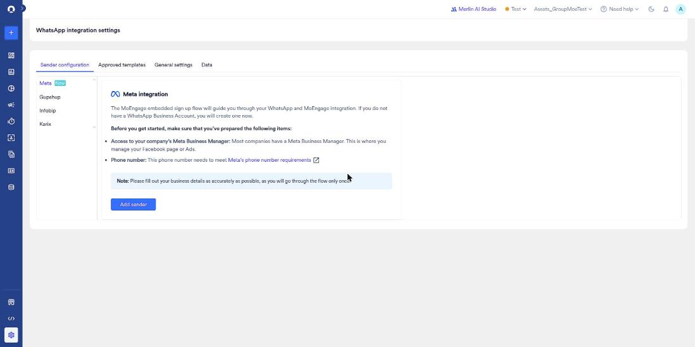
*Sender configuration > Meta (New): embedded sign-up intro with prerequisites (Meta Business Manager, phone number requirements) and the Add sender button*

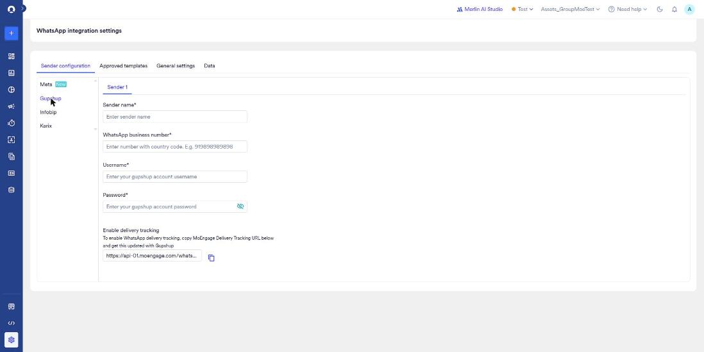
*Gupshup sender form: Sender name, WhatsApp business number, Username, Password, delivery tracking URL*

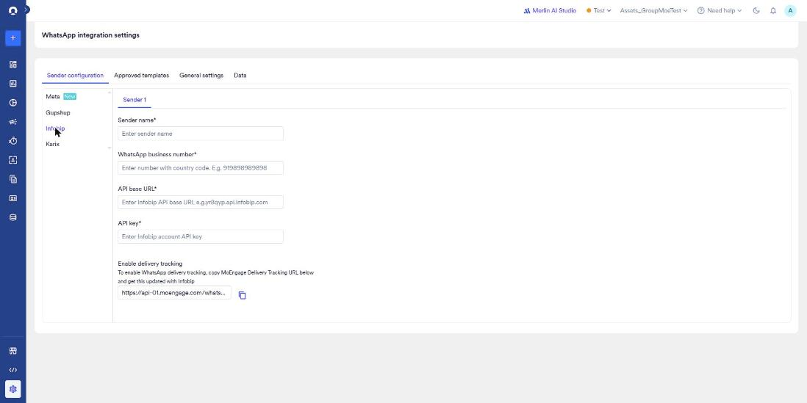
*Infobip sender form: Sender name, WhatsApp business number, API base URL, API key, delivery tracking URL*

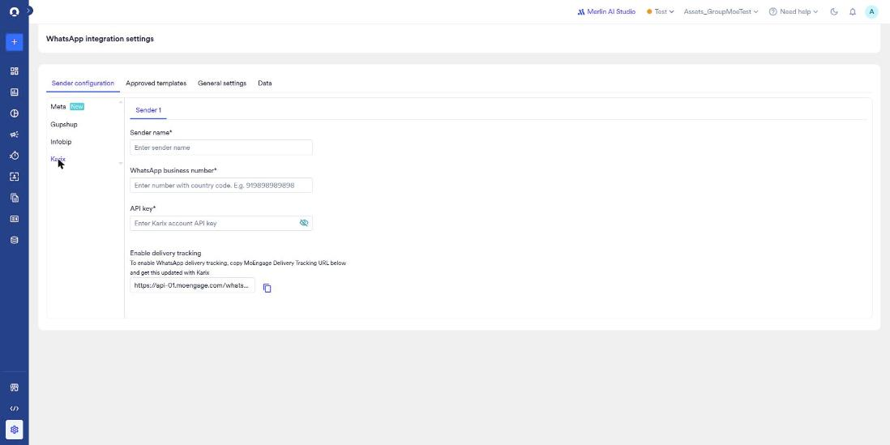
*Karix sender form: Sender name, WhatsApp business number, API key, delivery tracking URL*

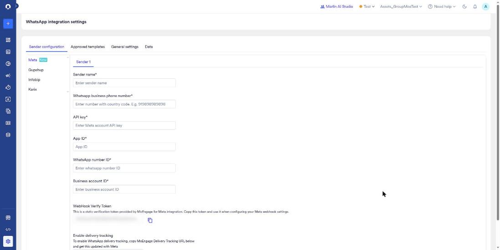
*Meta > Add sender (unsaved): manual Cloud API form with Sender name, phone number, API key, App ID, WhatsApp number ID and Business account ID; the webhook verify token is blurred locally*

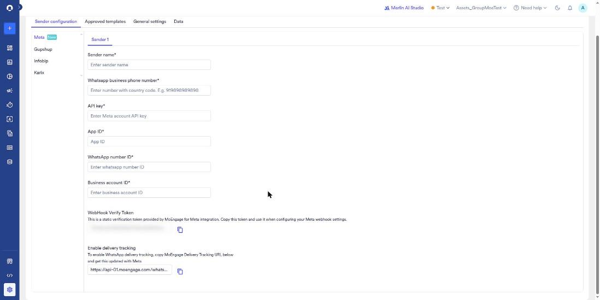
*Meta > Add sender form, lower part: WebHook Verify Token (blurred) with copy button, and the Enable delivery tracking URL*

#### WhatsApp integration settings: Approved templates

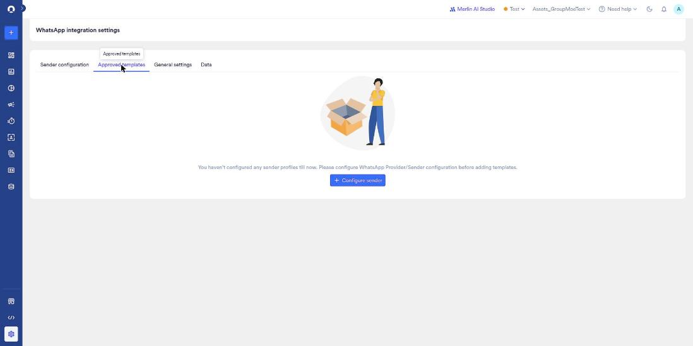
*Approved templates: empty state, no sender profiles, '+ Configure sender' CTA*

#### WhatsApp integration settings: General settings

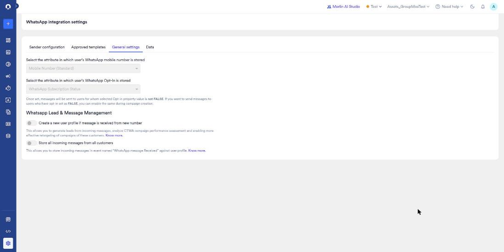
*General settings: mobile-number and opt-in attribute mapping, opt-in rule, and the Lead & Message Management toggles*

#### WhatsApp integration settings: Data

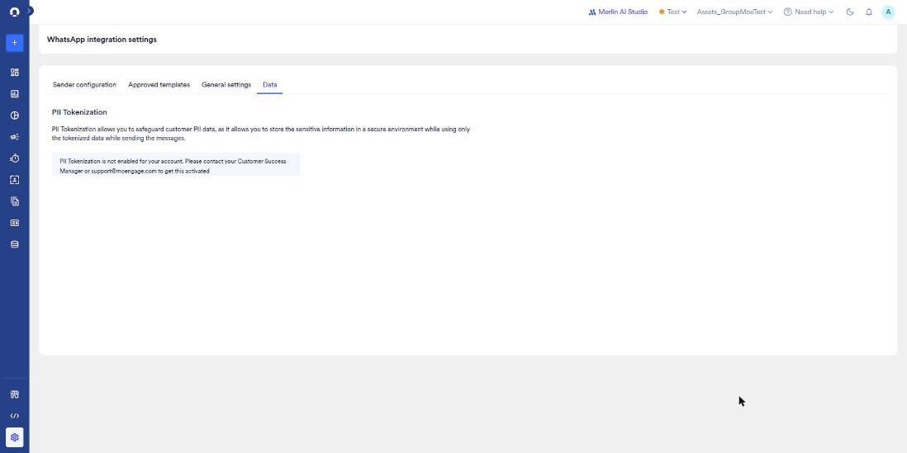
*Data tab: PII Tokenization is not enabled and needs the CSM or support*

#### Delivery controls: Frequency capping

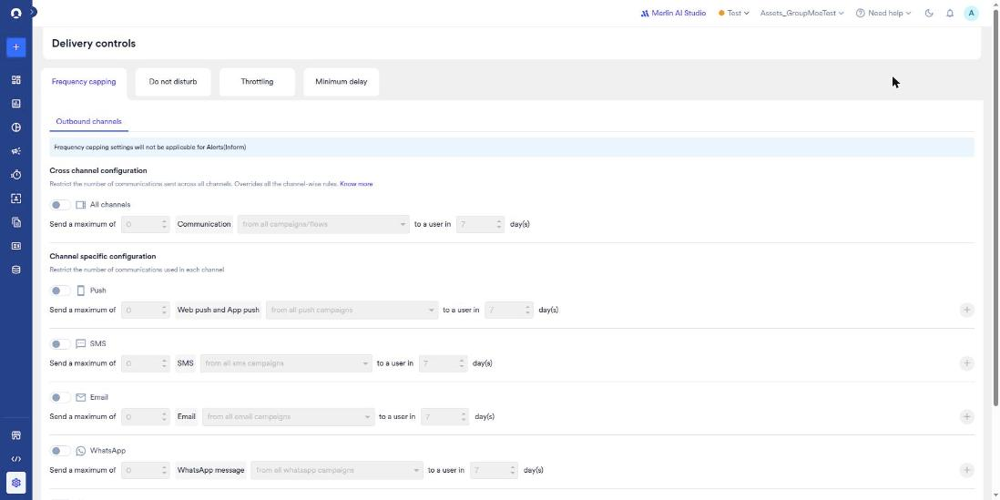
*Frequency capping: delivery-control tabs, the Inform banner, cross-channel cap, and Push/SMS/Email/WhatsApp rows*

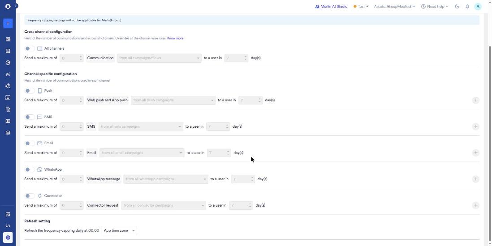
*Frequency capping, scrolled: all channel rows including Connector, and the daily 00:00 refresh setting*

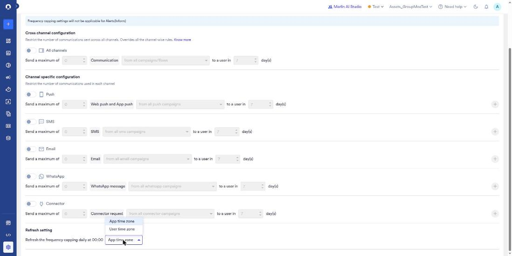
*Refresh time-zone dropdown open: App time zone / User time zone (closed with Escape, nothing selected)*

#### Delivery controls: Do not disturb

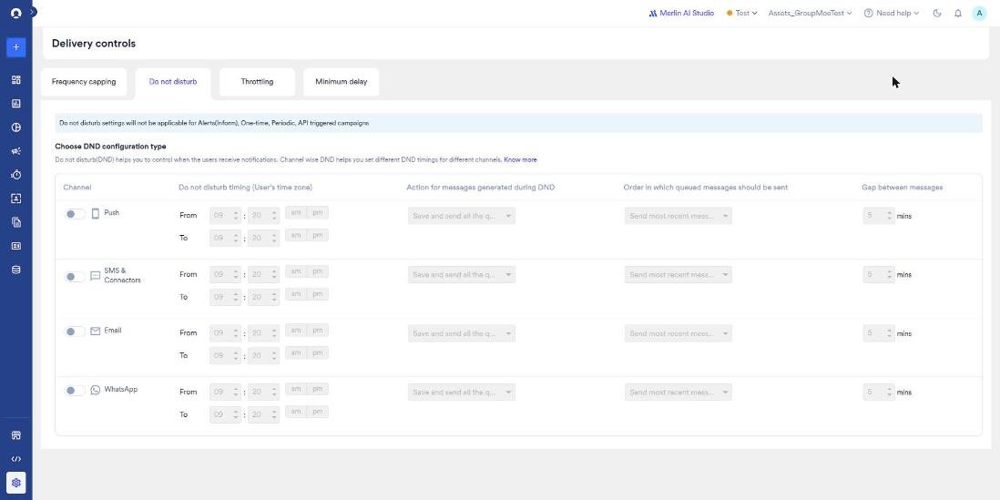
*Do not disturb: channel-wise DND table for Push, SMS & Connectors, Email, WhatsApp with timing, queued-message action, order and gap*

#### Delivery controls: Throttling

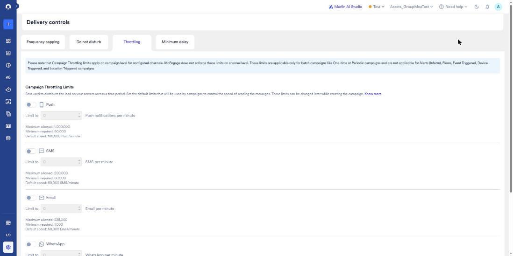
*Throttling: scope banner and Push/SMS/Email per-minute limits with max/min/default*

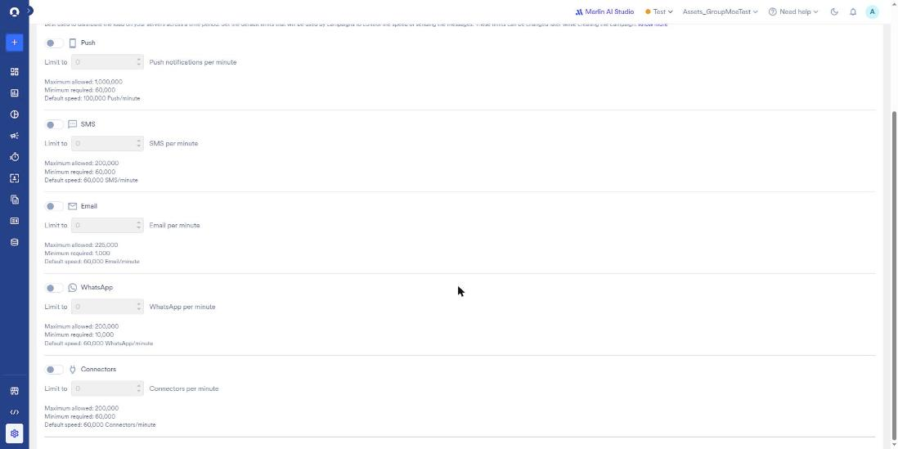
*Throttling, scrolled: WhatsApp (max 200,000 / min 10,000 / default 60,000 per minute) and Connectors limits*

#### Delivery controls: Minimum delay

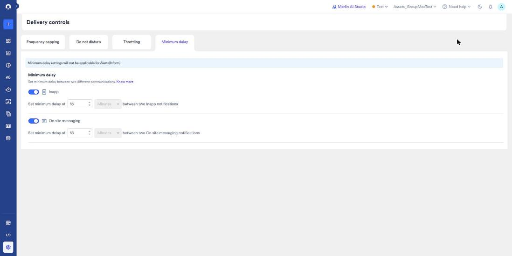
*Minimum delay: Inapp and On site messaging both enabled at 15 minutes*

#### Preference management

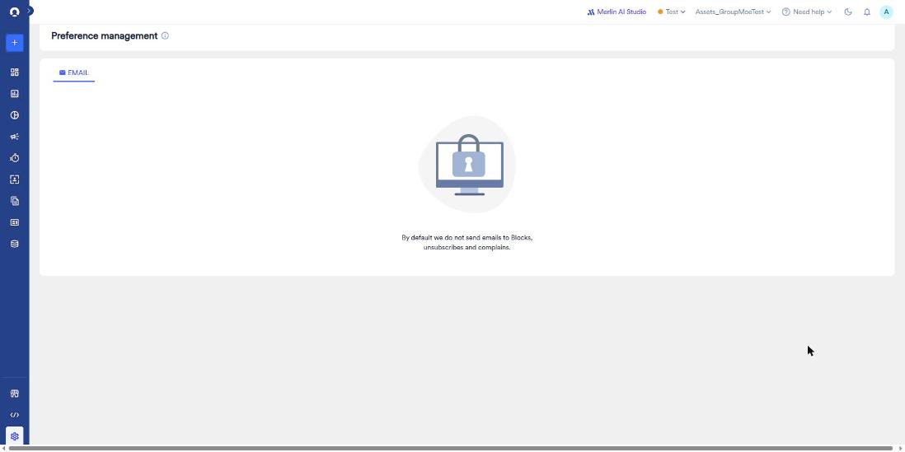
*Preference management: EMAIL tab only, lock illustration, 'we do not send emails to Blocks, unsubscribes and complains'*

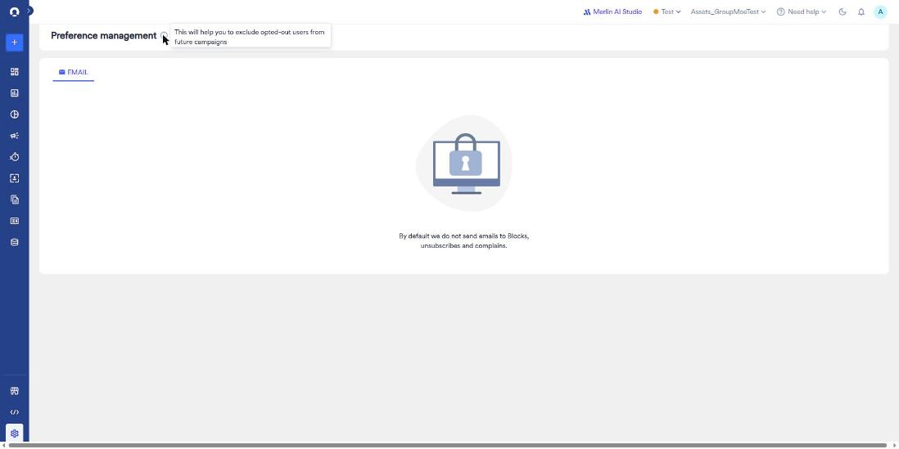
*Info tooltip: 'This will help you to exclude opted-out users from future campaigns'*
